<div align="center">


 [](README.md)

# Polaris

**A local-first to-do app for Windows 11**

Deep ink-dark UI · teal signal color · native window controls · your data stays on your machine by default

[](https://github.com/2dapeng518/Polaris-Todo/releases/latest)
[](#installation)
[](LICENSE)
[](https://github.com/2dapeng518/Polaris-Todo/releases)

</div>

Polaris targets the Windows 11 desktop. Built with Electron, it keeps your data in a local SQLite file — no account, no cloud sync. The UI ships in Simplified Chinese and English, with an emphasis on keyboard workflows, accessibility, and a quiet visual hierarchy: eight views, natural-language quick add, subtasks and tags, reminders and recurrence, a stats review — plus tray residency, a global hotkey, and silent background updates. Once installed, you barely have to think about it. It's just there.

<div align="center">
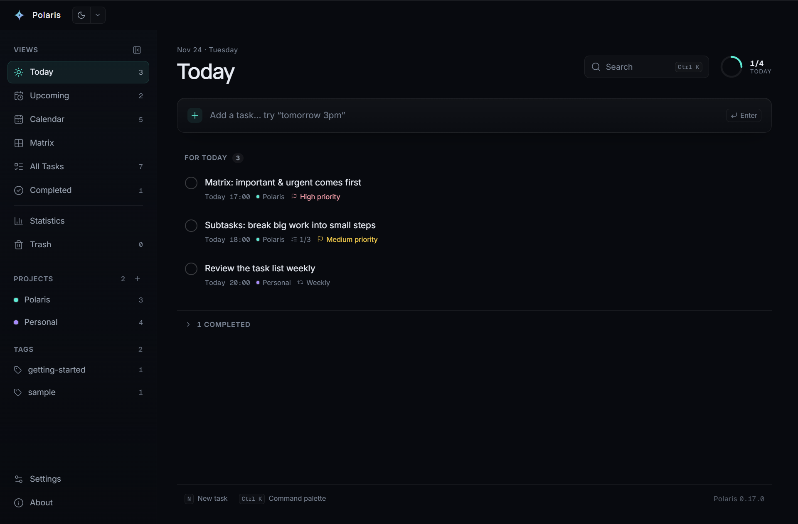
</div>

## Installation

Download `Polaris-Setup-<version>.exe` from [GitHub Releases](https://github.com/2dapeng518/Polaris-Todo/releases/latest): one-click install — double-click and it installs into your user directory (`%LOCALAPPDATA%\Programs`), no admin rights, no path picker, no confirmation prompts, and it launches automatically when done. The installer UI is in Simplified Chinese.

Once installed, the app keeps itself up to date: it checks for updates at startup, every 4 hours, and whenever the window regains focus or the system wakes from sleep (focus/wake checks are throttled to once per 30 minutes, so it won't hammer the network). Updates download in the background as deltas; clicking "Restart now" installs silently and relaunches the new version — no installer wizard at any point. Not clicking is fine too: the update installs automatically on the next normal quit. You can also skip a version (it just stops the automatic popup; the update still installs on quit), or check manually anytime from the tray or the Settings footer.

If you previously installed the "all users" build (under `C:\Program Files`), uninstall the old copy via Windows Settings > Apps before installing the new package: the old install location forces one UAC prompt per update; after migrating, updates are fully silent.

> [!NOTE]
> The installer is not code-signed, so the first run may trigger SmartScreen or an antivirus scan prompt. The app icon comes from `build/icon.ico` and can be regenerated with `npm run make:icon`.

## Features

### Views & Organization

- **Eight views**: Today / Upcoming / Calendar / Matrix / All Tasks / Completed / Stats / Trash. The sidebar groups them by workflow — working views on top, Stats and Trash below a divider in a review section; project and tag filtering, plus a today-progress ring. Completed items in lists collapse by default into a single "Completed · N" row — click to expand or collapse; checking a task off only bumps the count without disturbing the current list, and switching views re-collapses it.
- **Stats review**: completed today, completed this week (Monday-based), lifetime completions and on-time rate, 7-day / 30-day completion trend bars, and per-project lifetime share. Every number is derived locally from the task list — nothing extra is stored. Legacy tasks with no recorded completion time count toward lifetime totals and project distribution but not toward trends or the on-time rate; the UI notes how many.
- **Eisenhower matrix**: unfinished tasks are derived into Do now / Schedule / Quick wins / Later using "important = medium/high priority, urgent = due today or overdue". The 2×2 cards stack automatically on narrow screens; no due date means not urgent, and the classification re-evaluates across midnight.
- **Calendar**: a month grid places tasks on their due dates, weeks start on Monday, and a constant 42 cells keeps month flips from jumping. Each day shows up to three tasks inline, overflow collapses into +N, overdue items get a warning color, completed ones are dimmed and struck through, and medium/high priority carries a signal-color dot. Click a task to open its details; "Today" jumps back to the current month. Full keyboard navigation in the grid: arrow keys move by day/week, Home/End jump to the week's edges, PageUp/Down flip months, Shift combos flip years, Enter opens the day's first task.
- **Projects & tags**: create projects from the sidebar with six built-in colors; tags are created and attached with Enter in the detail pane, suggestion chips reuse them in one click, the sidebar filters by tag (mutually exclusive with project filtering), and deleting a tag cascades cleanup of its associations.

### Task Editing

- **Natural-language quick add (Chinese + English)**: type "下周三下午3点交季度报告 #Polaris !高" or "Call mom tomorrow 3pm" and the due date, project, and priority are recognized automatically — the title keeps only "交季度报告" / "Call mom". Recognition results appear as chips below the input, each individually undoable, and not a single character of your input is ever rewritten. Both Chinese and English syntax work regardless of the UI language. See [parsing rules](#quick-add-parsing-rules).
- **Task detail inspector**: an inline right column on wide screens that collapses to give the list room when closed; a modal drawer on narrow screens. Title and notes autosave; due date, reminder, and recurrence are edited in inline popovers, Esc saves and closes. Dates and times use the app's own drawn calendar and segmented time fields, not system controls; moving the due date shifts the reminder by the same offset.
- **Checklist (subtasks)**: a lightweight step list at the bottom of the detail pane — Enter adds continuously, per-row checkboxes, inline renaming, and deletions persist immediately; task rows show "2/5"-style progress. Subtasks have only a title and a done state; parent completion and subtask completion are independent.
- **Reminders**: at the due time a self-drawn reminder window pops up in the bottom-right corner — complete the task or snooze 10 minutes. Reminders missed while the app was closed fire on next launch.
- **Recurring tasks**: daily, weekdays, weekly, monthly, yearly. Completing an instance keeps it and generates the next one; reminders inherit their offset relative to the due date, subtasks are copied to the new instance and all reset to undone, and tags carry over.
- **Delete undo & trash**: a bottom "Undo" toast stays for 6 seconds (hover/focus pauses the timer), `Ctrl Z` works too; soft-deleted tasks go to the trash for 30 days with per-item restore. "Delete forever" and "Empty trash" both ask for confirmation, and expired items are purged automatically.
- **Write-failure feedback**: when a save, check-off, delete, undo, or read fails, an error toast appears at the bottom and un-persisted changes roll back — nothing is silently lost. It clears automatically after the next successful read/write, or you can dismiss it manually.

### Data & Integrations

- **Local SQLite**: data lives in Electron's `userData/polaris.db`, WAL mode, autosaved. The sidebar card "Task data stays on this device · autosaved · click to back up" jumps straight to the backup section in Settings — the privacy promise doubles as an exit: export anytime.
- **JSON backup**: one-click full export / import in Settings (`schemaVersion: 3`, including subtasks and tag associations); v1 / v2 backups still import, just without the newer data.
- **Automatic backup & disaster recovery**: on startup the app writes a JSON backup to `userData/backups/` (skipped if the newest one is under 24 hours old, atomic write, keeps the latest 21). The backup section in Settings expands into a list of automatic backups: import any of them (merges by ID — existing tasks are skipped, current data is never overwritten) or save a copy anywhere, and open the data folder in one click. If the database file is corrupted it is renamed and quarantined (including WAL sidecars — never overwritten or deleted), a fresh database is rebuilt, and a bilingual notice explains what happened. No silent data loss, no silent death.
- **CSV migration**: supports mainstream to-do app / Csv CSV exports, auto-detected by headers. Migrates titles, notes, priorities, due dates, projects (reused by name or created), tags, and Csv indented subtasks; completed tasks import as completed but without fabricated completion timestamps. Recurrence rules, reminders, attachments, and comments are not migrated.
- **Local MCP server**: opt-in in Settings (off by default), serving an MCP Streamable HTTP endpoint at `http://127.0.0.1:3737/mcp` so AI assistants can list / create / update / complete / delete tasks and query projects and tags. Eight tools call the exact same persistence logic as the UI — zero logic duplication. Clients must send an `Authorization: Bearer <token>` header — the token is generated on first enable (`sk-` prefix), shown in Settings → Local MCP in full plaintext (wrapping to two lines in a half-width card), copyable as a whole string in one click, and stable across restarts; "Regenerate" revokes the old token immediately. Legacy prefix-less tokens from 0.16.1 and earlier keep working after upgrade — configured clients need no changes; only newly generated / regenerated tokens carry the prefix.

> [!IMPORTANT]
> MCP binds only to the loopback address and requires bearer-token auth: a missing or wrong token always gets 401, so other local processes can't read or write tasks without the token. The token is stored only in the local database, data never leaves the machine, and the server runs with the app and stops when it exits.
> **Upgrade note (breaking)**: versions after 0.15.0 enforce token auth — existing MCP client configs must add the `Authorization: Bearer <token>` header to keep working.

### Desktop Experience

- **Tray residency**: closing the main window keeps the app in the system tray with reminders still running. Four tray menu items: Open Polaris / Settings / Check for updates / Quit. A manual update check always answers (balloon tip); the main window only surfaces when an update is actually found.
- **Global hotkey `Ctrl+Alt+P`**: press it from any app to summon Polaris, land on "Today", and focus quick add. On by default, toggleable in Settings; if the combo is taken, Settings shows a notice and everything else keeps working.
- **Launch at login**: starts hidden to the tray with `--hidden` after Windows sign-in; single-instance protection — launching again summons the existing window.
- **Online updates**: GitHub Releases channel, background delta downloads (blockmap). Download progress shows speed, downloaded / total bytes, and ETA — the speed/ETA line holds a permanent slot so flickering values never make the dialog jump; the post-100% verification gap shows "Verifying package" in that slot; release notes render as rich text (sanitized with DOMPurify). Three choices — "Skip this version / Later / Restart now"; clicking restart shows a "Restarting" acknowledgment before the process exits, default focus sits on "Later" so Enter can't restart by accident.
- **Splash animation**: a ~2-second brand animation — light points converge into a four-pointed star, the star ignites, an orbital ring travels, the wordmark settles. It follows your last theme choice with correct colors from the first frame, then fades out smoothly once the main window is ready — no white flash. Hidden on background auto-start.
- **Six themes**: three dark, three light, paired by color family (Nightfall ↔ Daylight, Dusk ↔ Sky, Pine ↔ Sand). A split toggle in the title bar swaps dark/light in one click; see [Themes](#themes).
- **Small-screen fit**: default and minimum window sizes hug the screen's work area and re-clamp when the resolution changes; 1024×576-class screens get a compact layout with independently scrolling sidebar navigation, and the storage card and Settings stay pinned at the bottom.
- **UI language**: switch between Simplified Chinese and English in the Settings "Color theme" section — UI text, date formats, and the tray menu update instantly and the choice is remembered; system notifications and native file dialogs follow the current language.
- **Keyboard-first & accessibility**: the command palette (`Ctrl K`), Settings, and the narrow-screen detail drawer have focus traps, while the wide-screen inspector keeps the list operable; skip link and reduced motion are supported; all ten input fields across the app share one soft-focus language (faint border + light halo), and focus rings never match their fill color.
- **Settings on one screen**: the Settings panel fits every window size in one screen with no vertical scroll (one unified two-column layout: left "Data backup", right "Local MCP + General", and a six-swatch theme strip sharing the header row — names and temperaments live in hover tooltips): the right column's fixed content pins the row height and its row descriptions are single-line ellipsis (errors replace the description in the same row, full text in the tooltip), while the left backup card absorbs the accordion's expansion (the list scrolls inside the card), so expanding / collapsing automatic backups leaves the panel, footer and right column pixel-identical; the backup buttons form a 2×2 grid and button labels never wrap inside a button. Each of the three groups lives in its own card, both columns equal-height in any state. The language dropdown sits at the right end of the theme row; the full plaintext token owns a full row (copy / regenerate right-aligned on a second row, the usage note lives in the reserved feedback slot); About & licenses live in a popover above the footer (zero layout growth when expanded, Esc / outside-click closes it). The panel's top edge is anchored to a nominal height and the scrollbar gutter is permanent — expanding About or enabling MCP never re-centers, re-flows, or changes scroll state; the update-status line holds a permanent single-line slot so check results land without jumping. The custom title bar keeps native Windows minimize / maximize / close buttons.
- **About & attribution**: the version number lives permanently in the Settings footer; expanding the "About & licenses" popover reveals the MIT license and font / icon credits. Full third-party component and font notices ship with the installer in `resources/NOTICE` and `resources/licenses/`.

## Screenshots

| Task detail inspector | Calendar view |
|---|---|
| 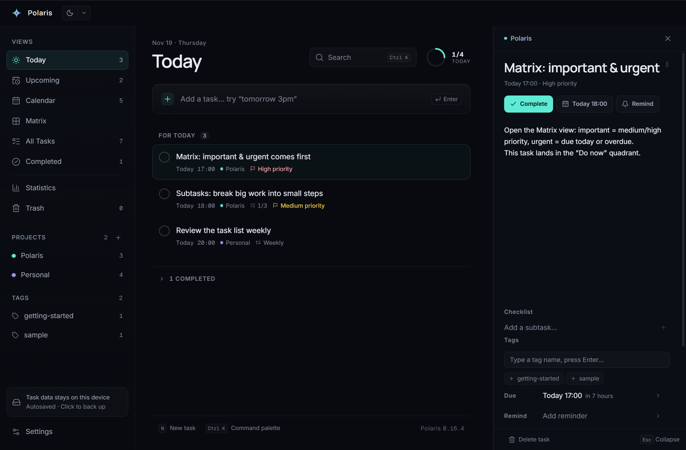 | 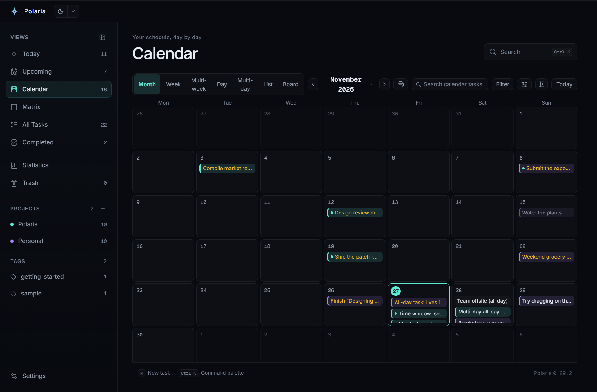 |

| Eisenhower matrix | Stats review |
|---|---|
| 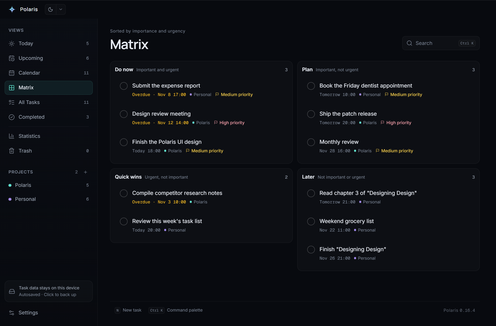 | 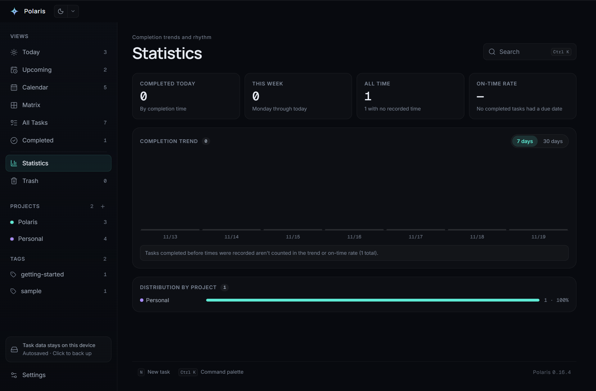 |

| Settings panel | Command palette |
|---|---|
| 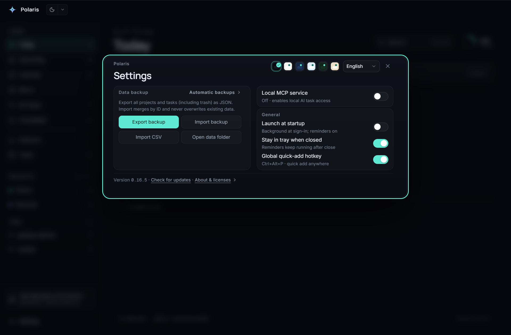 | 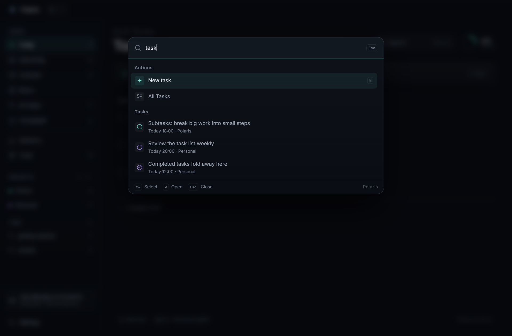 |

## Themes

Six color themes — three dark, three light, paired by family, one dark and one light per pair:

| Dark | Light | Character |
|---|---|---|
| Nightfall `dark` | Daylight `light` | Cold ink night ↔ warm porcelain day (classic neutral) |
| Dusk `dusk` | Sky `sky` | Deep blue tones ↔ clear-sky blue |
| Pine `green` | Sand `sand` | Pine-ink night, calm and easy on the eyes ↔ oat-warm sand, gentle daylight |

- The title bar carries a **split toggle**: the left segment flips between the pair in one click (two clicks always return to the original theme), the right arrow opens a six-way menu. The six-swatch strip in Settings offers the same choices (names and temperaments in hover tooltips), and the command palette has six direct commands like "Theme: Nightfall".
- Switching applies instantly and is remembered: with View Transitions support it does a ~200ms soft cross-fade; under reduced motion it switches directly. First launch follows the system light/dark preference.
- The teal signal color is unified across all themes, each canvas has its own character, and text contrast meets WCAG AA everywhere (`npm run verify:themes` checks this continuously).

One pair per column, dark on top:

| Nightfall ↔ Daylight | Dusk ↔ Sky | Pine ↔ Sand |
|---|---|---|
| 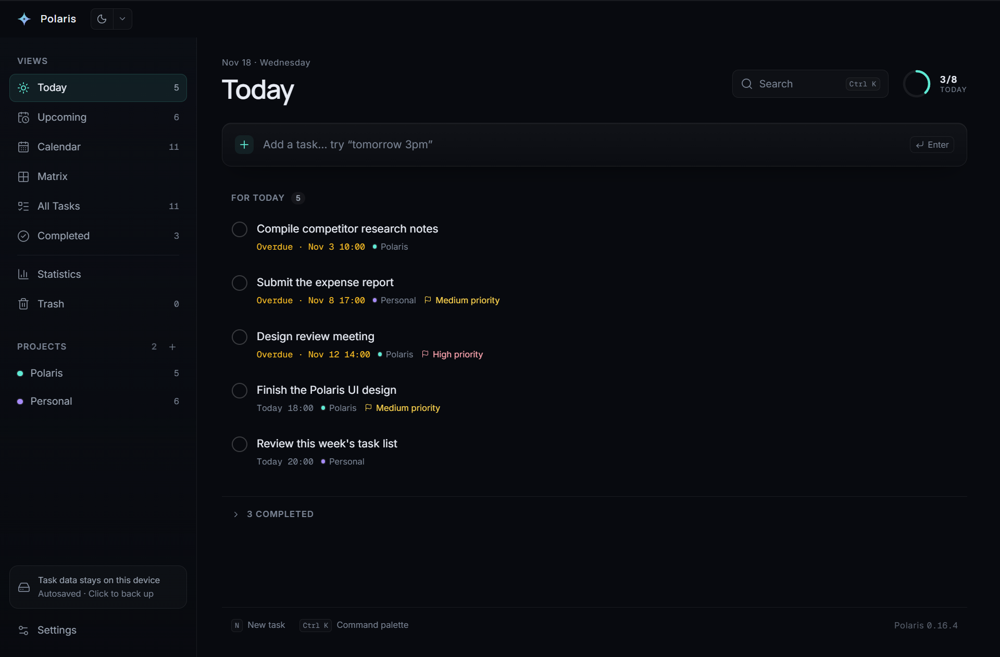 | 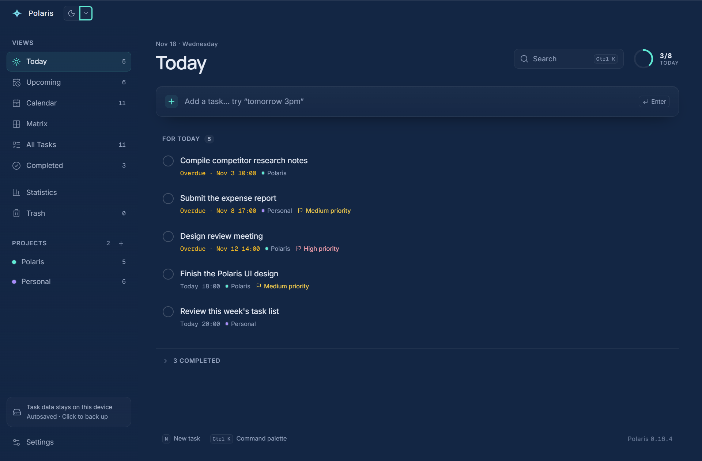 | 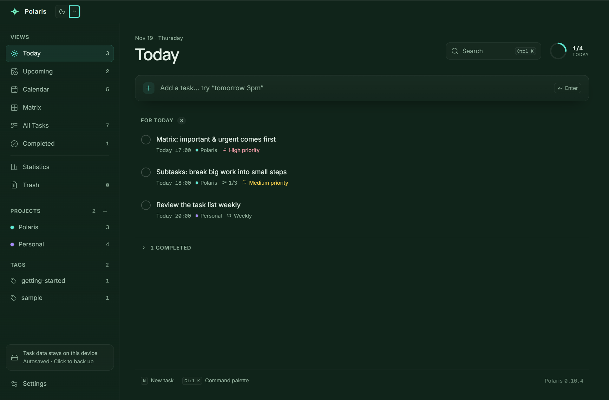 |
| 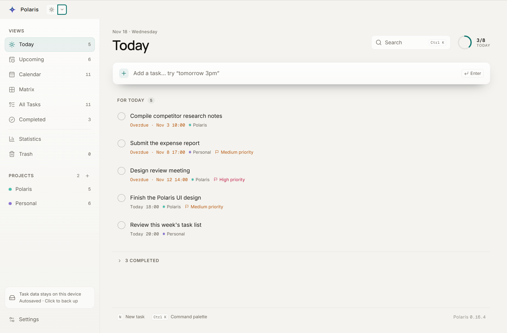 | 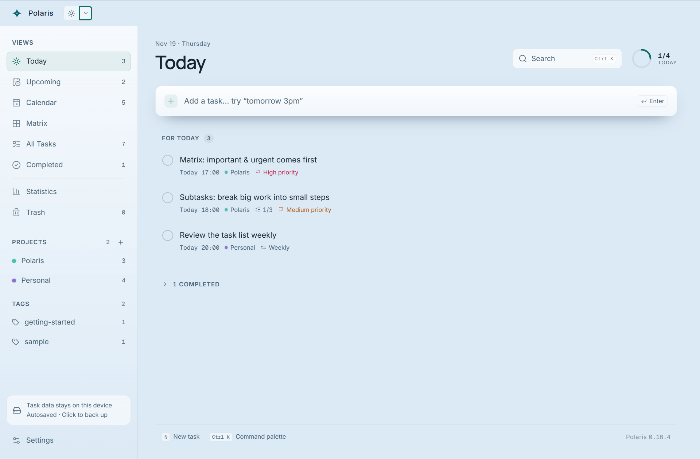 | 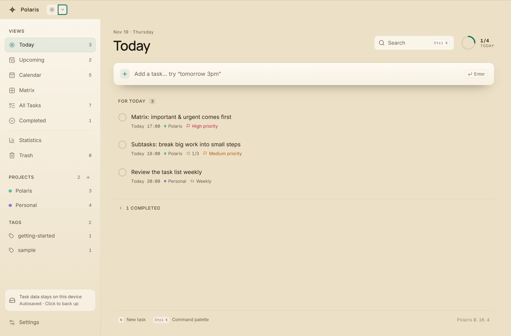 |

## Keyboard Shortcuts

| Shortcut | Action |
|---|---|
| `N` | Focus quick add (routes back to "Today" from Stats / Matrix / Calendar / Trash) |
| `Ctrl Alt P` | Global hotkey: summon Polaris from any app, land on "Today", focus quick add (toggleable in Settings) |
| `Ctrl K` | Open the command palette: search tasks, switch views, create tasks or projects, quick-switch themes |
| `Enter` | Save quick add / open the selected item |
| `Tab` | Move from quick add to the recognition chips |
| `Backspace` | On a recognition chip, cancel that recognition |
| `Esc` | Clear the quick-add draft; or save and close the detail pane; or close the palette / popover / confirm dialog |
| `Ctrl Z` | Undo the most recent deletion (inside inputs, native text undo is preserved) |

## Quick-Add Parsing Rules

Write dates, times, `#project`, and `!priority` directly in quick add — recognition results appear as clickable chips below the input. **Your input text is always preserved verbatim**; clicking a chip only cancels that recognition, and the cancelled text returns to the title.

### Supported Syntax

| Category | Examples |
|---|---|
| Chinese relative days | 今天、明天、后天、大后天、今儿、明儿 |
| Chinese relative day + period | 今晚、明早、明晚、后晨 |
| Chinese weekdays | 周三、下周三、本周五、下下周一、星期天、礼拜天、周3、下个星期三 |
| Chinese month-day | 11月20日、11月20号、十一月二十日、2027年1月5日 |
| ISO dates | 2026-11-20 |
| Chinese clock times | 下午3点、三点半、十点一刻、两点钟、10点15分、凌晨2点 |
| 24-hour times | 15:00、下午3:00 |
| Bare Chinese periods | 上午、中午、下午、晚上、傍晚、凌晨、早上、早晨 |
| Chinese deadline suffixes | 明天前、周五之前、今天之内 |
| English relative days | today, tonight, tomorrow, day after tomorrow (short forms tmr, tmw) |
| English weekdays | friday, fri, next friday, this friday, on friday |
| English times | 3pm, 3:30pm, 3 pm, at 3, noon, midnight, morning, afternoon, evening |
| English offsets | in 2 hours, in 30 minutes, in 3 days, in 2 weeks |
| English month-day | dec 25, december 25, 25 dec, 12/25, jan 5 2027 (US month/day order) |
| Projects | `#Polaris` (matches existing projects, case-insensitive, longest name wins) |
| Priorities | `!高` `!中` `!低`, or `!3` `!2` `!1`, or `!high` `!medium` `!med` `!low` |

Full-width `＃` `！` `：` and full-width digits are treated as half-width. Date and time can be written separately — "明天 交报告 下午3点" works just as well. English and Chinese syntax can mix: "明天 3pm 开会" parses too.

### Leading and Trailing Clusters Only

Dates are recognized only in a **leading cluster** or a **trailing cluster**. The "下周三" in "把下周三的报告提前" sits mid-sentence and won't be consumed. Lead-in phrases like "记得 / 别忘了 / 提醒我 / 安排一下" are allowed at the start; they stay in the title.

### How Times Are Decided

- Date without a time → 23:59:59 that day; the chip shows only the date and weekday.
- An explicit clock time → that exact time. "今晚8点" means 20:00.
- Period only ("晚上买菜") → a default time (dawn 5, early morning 7, morning 9, noon 12, afternoon 15, dusk 18, evening 20); the chip marks the time as inferred. If that time has already passed and the date is explicit, it falls back to 23:59:59 that day rather than showing a made-up time.
- Bare hours 1–6 are read as afternoon ("3点开会" = 15:00); but if the result lands today and the morning reading hasn't passed yet, morning wins (saying "6点起床" at 5am = today 06:00). Saying "6点起床" at 19:00 yields tomorrow 18:00 — a known edge of this heuristic.
- Time only, no date, and the time has passed → rolls to tomorrow; the chip explicitly says "tomorrow".
- With an explicit date, never rolls forward: saying "今天下午3点" at 16:00 is simply overdue, and the chip says so honestly.
- Nothing recognized → the view's default applies (Today view 23:59, Upcoming view next day 09:00, others no date).

### English Syntax

English syntax is independent of the UI language: "tomorrow 3pm" works in the Chinese UI, and "明天" works in the English UI.

- Date without a time (`tomorrow`, `dec 25`) → 23:59:59 that day, same as Chinese.
- Period only (`morning`, `afternoon`, `evening`) → default times 09:00, 15:00, 20:00 respectively, matching Chinese 上午/下午/晚上; the chip marks the time as inferred. `tonight` means 20:00, `noon` 12:00, `midnight` next day 00:00.
- `3pm`, `3:30pm`, `3 pm`, `at 3` all parse; `at 3` without am/pm uses the same bare-hour heuristic as Chinese (hours 1–6 read as afternoon).
- `in 2 hours`, `in 30 minutes`, `in 3 days`, `in 2 weeks` add the offset to the current moment; the chip shows the exact time.
- `next friday` means Friday of next week (aligned with 「下周五」); `this friday` is not recognized at all if this week's Friday has passed — the text stays in the title (aligned with 「本周五」); bare `friday` picks the nearest future Friday.
- Abbreviations are both weekday words and ordinary words: bare `sat`/`sun`/`mon` are consumed only when they look like dates (lowercase, not followed by an ordinary word, not preceded by a pronoun) — `Sat down`, `Sun Microsystems`, `SAT scores`, `Mon ami` all stay verbatim. Weekday words relax when paired with `next`/`this`/`on`.
- Month names count as dates only when adjacent to a day number: `May the force be with you`, `march forward`, `April is nice` are not dates; greetings like `good morning` are never recognized.
- English dates also honor leading/trailing clusters only: the mid-sentence `friday` in "call mom on friday please" stays untouched.

<details>
<summary><b>Deliberately unrecognized patterns</b> (so title words are never mistaken for dates)</summary>

None of the following are parsed:

- Past-directed: 昨天、前天、上周三、去年
- Recurrence phrases: 每天、每周三、每月15号、工作日 (use the recurrence rules in the detail pane instead)
- Quantifiers: 下周三个人来面试、本周三场比赛、一周三次、5点半价门票
- Ordinals and measure words: 第3点、3点注意事项、2点建议、3点方向
- Ranges: 周一到周五、3点到5点、15:00到17:00
- Vague / relative durations: 3天后、半小时后、10点差5分、10点左右、上午10点光景
- Decimal points: 沪指涨1.5点
- Elliptical forms: 15号、11月、11/20、11.20、2026-11-20T15:00
- Proper names and fixed words: 周六福、周一围、下午茶、早上好、今日头条、明早期瓷器、下周日程、今日志导出
- Purely numeric tags: `#123`, `issue#123`, `C#开发教程`

When `#project` matches no existing project, a non-clickable notice "未找到「X」" appears and the text stays in the title; when multiple projects share the name, it doesn't guess — it shows "有 N 个「X」，未指定项目".

</details>

<details>
<summary><b>Date-time picker & keyboard operation</b></summary>

The due-date and reminder popovers contain Polaris's own drawn calendar, not a system dialog. Quick chips on top, the month grid in the middle, and a time groove below (hour : minute + period word) with ±15-minute buttons. Use the "Clear due date" button to remove a date.

| Key | Action |
|---|---|
| `←` `→` | Previous / next day |
| `↑` `↓` | Previous / next week |
| `Home` `End` | This week's Monday / Sunday |
| `PageUp` `PageDown` | Previous / next month |
| `Shift PageUp` `Shift PageDown` | Previous / next year |
| `Enter` `Space` | Select the day and jump to the time field |

Type digits directly in the time field: "1830" takes four keystrokes, a lone "9" works too; filling the hour auto-advances to minutes. `↑` `↓` step ±1 within the field with wraparound (23→00, 59→00); `Shift ↑` `Shift ↓` equal the ±15 buttons — shifting 15 minutes as a whole without crossing the day. `Home` `End` take the field's min/max, `Enter` commits and closes the popover.

Three states look different on the grid: the selected day is solid teal, today is a teal outline with a dot below, and the draft day (when nothing is set) is a dashed teal frame. The "Today" button never sets a time in the past — if the current moment has passed the default, it rolls to the next 5-minute mark.

**Recognition bar keyboard & accessibility**: `Tab` moves from the input to "keep as text" and then across the chips; `Enter` or `Backspace` cancels a recognition; `Esc` clears the whole draft. After a keyboard cancel, focus stays inside the recognition bar instead of jumping back to the input. Date-only input like "明天下午3点" with no task name blocks `Enter` and announces "还差一个任务名" to screen readers. During IME composition, `Enter` does not submit.

</details>

## Tech Stack

| Category | Technology | Version |
|---|---|---|
| Runtime | Electron | 45.3 (Chromium 156 / Node 24) |
| Build | electron-vite / Vite / TypeScript | 6.0 / 8.3 / 7.0 |
| UI | React / Tailwind CSS / Motion / Zustand | 19.3 / 4.3 / 14.12 / 5.1 |
| Data | better-sqlite3 / rrule / zod | 13.0 / 2.8 / 4.6 |
| Updates | electron-updater / DOMPurify | 6.8 / 3.4 |
| Logging | electron-log | 5.4 |
| Packaging | electron-builder (NSIS) | 26.18 |
| Icons & dates | lucide-react / date-fns | 1.72 / 4.4 |

Fonts: Manrope (headings), Inter (body), Noto Sans SC (Chinese), Geist Mono (numbers and time).

## Architecture

```text
┌────────────────────────────────────────────────────┐
│ Renderer (React 19 + Zustand + Motion)              │
│ Views / detail / palette / reminder / settings /    │
│ update dialog                                       │
└───────────────────┬────────────────────────────────┘
                    │ window.polaris (preload contextBridge)
┌───────────────────▼────────────────────────────────┐
│ Main (Electron 45)                                  │
│ IPC + zod · SQLite · reminder scheduling · tray ·   │
│ auto-launch · global hotkey · updates · local MCP · │
│ splash                                              │
└────────────────────────────────────────────────────┘
```

- The main process owns window lifecycle, SQLite, reminder scheduling, tray, launch-at-login, the global hotkey, online updates, and the local MCP server; the renderer runs under `contextIsolation` + `sandbox` with no direct Node access.
- `src/preload/index.ts` exposes a typed `window.polaris` via `contextBridge`; data IPC arguments are validated with zod in `src/main/ipc.ts`.
- `src/shared/` holds types, the theme registry, recurrence computation, quick-add parsing, and CSV parsing shared by both processes — no duplicated implementations.
- The database lives at Electron's `userData/polaris.db` in WAL mode; tasks use soft deletion, restored by undo and trash recovery, with retention rules in `src/shared/retention.ts`.
- The reminder window reuses the same renderer entry, loading `ReminderView` via `#/reminder/<taskId>`; the splash is a second renderer entry `splash.html` with theme and version injected by the main process — correct colors from the first frame.
- Update state flows one way: the main process pushes snapshots over `update:state` (the app's only push channel); the renderer never derives progress on its own.
- There is no router in the renderer — views, project filters, the selected task, and palette state all live in Zustand.

For finer module boundaries and modification notes, see [CLAUDE.md](CLAUDE.md).

## Quick Start (Development)

Prerequisites:

- Windows 11 (target platform)
- Node.js and npm (verified dev environment: Node 26.13 / npm 11.20)

```bash
npm install
npm run dev
```

> [!TIP]
> If the Electron binary is missing after install (npm 11 blocks lifecycle scripts by default), run `node node_modules/electron/install.js`. The `allowScripts` list in `package.json` names the dependencies that need install scripts.

Common commands:

| Command | Purpose |
|---|---|
| `npm run dev` | Start the electron-vite dev server |
| `npm run typecheck` | TypeScript checks for main + renderer |
| `npm run build` | Build to `out/` |
| `npm run smoke` | Launch the real app and run smoke tests (requires `npm run build` first) |
| `npm run verify:themes` | Theme contrast and registry invariant checks |
| `npm run verify:datetime` | Date-time pure-function invariant checks ("Today" never lands in the past, etc.) |
| `npm run verify:pure` | Quick-add parsing + trash retention truth-table checks (pure Node, no Electron) |
| `npm run preview` | Preview the production build |
| `npm run build:win` | Build and produce the NSIS installer (`--publish never`, no upload) |
| `npm run build:mac` | Build and produce the macOS installer |
| `npm run release:win` | Build and publish to GitHub Releases (requires `GH_TOKEN`) |
| `npm run make:icon` | Regenerate app icons (png/ico/icns) and the tray icon |

During development, closing the main window only hides it to the tray; end `npm run dev` via the tray's "Quit" or `Ctrl+C`. First launch creates the database and seeds a set of tutorial sample tasks: each demonstrates one feature (quick add, subtasks, tags, recurrence, reminders, matrix, completed section), with the how-to in its notes.

## Directory Structure

```text
src/
  main/        Electron main process, SQLite, IPC, reminders, tray, auto-launch, hotkey, updates, MCP
  preload/     contextBridge API
  shared/      Shared types, theme registry, recurrence, quick-add parsing, CSV parsing
  renderer/
    index.html
    splash.html    Splash screen (separate small-window entry)
    src/
      components/  Views, detail, palette, reminder, settings, update dialog, toasts
      lib/         Date formatting, stats derivation, focus traps
      stores/      Zustand state
      styles/      Single stylesheet globals.css
scripts/       Smoke-test launcher, theme/date/pure-function verify scripts, icon generation
design-system/ Polaris brand system, tokens, component specs
build/         App icons and installer resources
```

## Development Workflow

The repo uses `main` as its primary branch, with basic CI configured (typecheck + theme/date/pure-function checks, see `.github/workflows/ci.yml`). Recommended local flow:

1. Change code and verify interactions with `npm run dev`.
2. Run `npm run typecheck`.
3. Run `npm run build && npm run smoke`; if you touched themes add `npm run verify:themes`, if you touched `lib/dateTime.ts` add `npm run verify:datetime`, and if you touched `shared/quickAddParse.ts` / `shared/retention.ts` run the seconds-fast `npm run verify:pure` first for quick feedback.
4. For visual results, rebuild with the harness first via `POLARIS_HARNESS=1 npm run build` (production builds strip the screenshot code — shooting without it silently produces nothing), then `POLARIS_SHOT=<mode> npx electron .` to capture into the repo root (mode list in the collapsed block below); afterwards run `npm run build` once to restore the production state. Add `--user-data-dir` when verifying to avoid rewriting the theme in your real profile directory. For English-UI screenshots add `POLARIS_LOCALE=en` (first-launch seeds and capture selectors follow the language); they are archived in `docs/screenshots/en/` and referenced by `README.en.md`.
5. Release: bump the version in `package.json` → commit and create an annotated tag → **push main and the tag first** (otherwise electron-builder may race and create the tag on an old HEAD) → set `GH_TOKEN` and run `npm run release:win`. After publishing, verify the Release has all three assets: `Polaris-Setup-<version>.exe`, `.blockmap`, `latest.yml` (electron-builder occasionally drops uploads silently — patch missing ones with `gh release upload --clobber`); if the Release sits in DRAFT, promote it with `gh release edit --draft=false`.

<details>
<summary><b>POLARIS_SHOT screenshot mode list</b></summary>

Modes include `detail`, `palette`, `projects`, `reminder`, `reminder-detail`, `settings`, `theme-menu`, `palette-theme`, `toast`, `recurrence`, `parse`, `parse-past`, `parse-notice`, `parse-blocked`, `due-picker`, `due-clear`, `trash` and their `light-` variants, plus dark-only `trash-confirm` (the trash delete-forever confirm dialog), `narrow` (shrinks the window to 1100×800 before shooting the detail pane), `calendar` (self-seeds eight tasks scattered across the current month including overdue and one completed, hard-deletes them afterwards), `matrix` and `stats` (shoot the matrix and stats with first-launch sample data), `themes` (captures all six themes' main view, the expanded theme menu, and the theme picker), and `splash` (captures the splash in all six themes without touching the main window's theme). Trash screenshots self-seed two deleted tasks and hard-delete them afterwards. README screenshots are archived in `docs/screenshots/` (Chinese UI) and `docs/screenshots/en/` (English UI).

</details>

Build artifacts:

- `dist/Polaris-Setup-<version>.exe`: NSIS one-click installer, installs into the current user's directory, no admin rights, auto-launches when done.
- `dist/Polaris-Setup-<version>.exe.blockmap` and `dist/latest.yml`: delta-download and version metadata for online updates, uploaded alongside the installer on release.
- `dist/win-unpacked/Polaris.exe`: portable unpacked build.
- `npm run build:mac` is also available (macOS packaging config, icon `build/icon.icns`); the primary target platform remains Windows 11.

## Testing

The repo has no unit-test framework like vitest/jest and no lint script. Automated checks are the smoke tests, theme verification, date-time verification, and the fast pure-function verification:

```bash
npm run build
npm run smoke
npm run verify:themes
npm run verify:datetime
npm run verify:pure
```

- **Smoke tests** (`scripts/smoke.mjs`) launch real Electron and drive the UI via `webContents.executeJavaScript` — 163 named assertions covering the full chain from quick add to online updates. They use a temporary userData profile, never touch your real data, exit non-zero on failure, and print `POLARIS_SMOKE_FAILED ["assertion", …]` separately.
- **Theme verification** checks WCAG contrast across all six themes, registry invariants, and cross-family pairing.
- **Date-time verification** imports the renderer's pure functions directly with an injected clock, using literal expectation tables plus a full-day scan of 5760 real moments, then covers every 2026 DST transition across 7 time zones (17280 real moments total) — pinning down edges like "the Today button never lands in the past" that UI runs would only hit by chance.
- **Fast pure-function verification** (`npm run verify:pure`, wired into CI) skips Electron entirely, importing `shared/quickAddParse.ts` and `shared/retention.ts` directly in Node to run — in seconds — the same Chinese/English parsing truth tables, false-positive counterexamples, undo state machine, and retention boundary tables as the smoke harness. The two assertion tables must be maintained in sync (the originals in `src/main/harness/assertions.ts` stay; E2E still runs them).

All expected values are written as literals, never computed through the code under test; cross-process waits use condition polling, never fixed delays. Height assertions use sub-pixel rectangles; smoke emulates 125/150/200% display scaling and a 1024×536 low-resolution viewport via CDP. Details like segment widths, dividers, and small-font Chinese still rely on manual review. Visual checks go through `POLARIS_SHOT` screenshots (rebuild with the harness first — see workflow step 4); screenshots and smoke tests must run locally.

<details>
<summary><b>Assertion coverage breakdown</b></summary>

**Main chain**: quick add, detail editing, completion, delete and undo, command palette, theme switching, theme menu, launch-at-login, recurring tasks, the "next instance created" toast, write-failure feedback, and the full trash chain (delete to trash, restore to the main list, delete-forever confirm dialog and Esc cancel, empty trash, empty-state copy). Write-failure visibility is exercised by temporarily detaching the `tasks:update` / `tasks:delete` / `tasks:restore` / `tasks:list` / `tasks:delete-forever` channels to cause real persistence failures, verifying error copy, optimistic rollback, the undo button surviving a failed undo, and the toast clearing after a successful retry or manual dismissal; the production IPC handlers are restored afterwards. Trash retention boundaries (null / 29 days / exactly 30 days / ±1 ms / invalid / future) are pinned by `runRetentionAssertions()` with literal expectation tables, and the `deletedAt` field chain verifies empty on create, stamped on soft delete, cleared on restore.

**Checklist**: add / check / inline rename / delete in the detail pane, literal progress values on task rows and in the detail pane, re-reading the database to confirm persistence, new recurrence instances reset while old ones persist, subtasks cleared after the parent is deleted forever, plus v2 backups carrying subtasks and v1 backups importing despite lacking the `subtasks` field.

**Tags**: creating and attaching tags in the detail pane, task-row chips, sidebar counts and filter hit counts, tag deletion cascading chip cleanup, new recurrence instances inheriting tags, plus v3 backups carrying tags and associations while v1/v2 backups still import.

**Matrix**: palette direct navigation, four self-seeded tasks landing in the four quadrants with literal expectations, quadrant title order, count badges consistent with rendered rows, clicking a task row opens the detail pane.

**CSV migration**: pure-function truth tables (format detection, quote escaping, BOM/CRLF, indented subtasks, priority mapping, recurrence descriptions not guessing due dates) plus real persistence round-trips for both formats.

**Calendar**: palette direct navigation, 42 cells, tasks placed by due date, no-due-date tasks excluded, month-flip labels and cell counts, the Today button returning to the current month, chips opening the detail pane.

**Local MCP**: real HTTP round-trips (bearer token fetched via IPC) — initialize / tools/list / create task / list tasks / complete task / GET returns 405 / missing and wrong tokens get 401 / after regeneration the old token gets 401 and the new one 200 / connections refused when disabled; token shape pinned to `sk-` prefix + 64 hex chars, repeated reads return the same value.

**Online updates**: pure-function truth tables; dev-mode manual check answers unsupported without a dialog; synthetic snapshots drive found→progress→ready→later-stays-quiet→skip-stays-quiet; skip persistence and footer re-opening; HTML release notes rendered as rich text (an injected `<script>` is sanitized and never executes); the dev-mode install guard errors without killing the process; zero-jitter update dialog guards (speed null→value→null→100% verification, four snapshots with zero displacement of the panel's top edge and height, verification copy landing in its slot, restart showing "Restarting" feedback first with the guard erroring without killing the process, error snapshots resetting buttons to clickable).

**Tray & hotkey**: post-build menu labels are exactly four items; tray "Settings" summons the window and opens the panel; manual-check balloon copy truth table across seven states; dev-mode checks neither popup nor summon; hotkey on by default, Settings round-trip, conflict degradation notice, hidden-window summon lands on "Today" with the input focused.

**Layout & focus**: Settings one-screen guard (default 840 and compact tiers, measured after clicking check-for-updates so the status row exists); the 1024×536 low-resolution compact tier applies with no sidebar/main overflow; the storage card jumps to the backup section. A dedicated one-screen guard measures the MCP-on worst case in both languages across five window sizes (including the real 683×607 width and the 1280×900 tall tier): scrollHeight ≤ clientHeight everywhere. The Settings zero-jitter guard measures at the real 1024×576 tier: full plaintext token on screen, constant wrap-box height, single-line feedback slot, exactly the copy and regenerate buttons, and zero displacement of panel content height and footer top edge before/after check results land in their slot. The layout-v2 guard additionally verifies two-column orientation (left backup card, right MCP + General), the language dropdown's position, equal column heights (backup card vs right column), and the About collapse round-trip, with the token box owning the majority of the token row's width. The backup zero-jitter guard expands the automatic-backup accordion with three fixture backups at 1024×576 and asserts the rows render inside the stretched card while panel content height, footer top edge, outer frame and right-column height stay pixel-identical across expand and collapse. The top-edge anchoring guard verifies at 1280×843 that expanding/collapsing About leaves the panel top edge, footer top edge, outer height, content height, and content width pixel-identical (the zero-growth popover contract). Focus-ring scans cover five states — main view, detail pane, date popover, expanded theme menu, trash confirm dialog — failing if any ring matches its own fill/border color.

**Themes**: pair quick-toggle returns to the original theme after two clicks (verified for all three pairs); the six-theme matrix's `data-theme` / persistence / token application; the title-bar theme menu (all six rows in fixed order, opening focuses the current row, selection persists, `aria-expanded` resets after unmount, focus returns to the arrow, Esc closes only the menu); and typing "主题" in the palette hits six direct commands that apply on selection.

**Data layer**: same due moment sorts by priority high→low without earlier moments being reordered by priority; `completedAt` empty on create, written on completion, untouched by later title edits (`updated_at` does change), cleared on un-completion, re-stamped with a new moment on re-completion; completing a recurring instance keeps its timestamp while the generated next instance has none.

**Completed collapse & list scale**: the completed section collapses by default into one "Completed · N" row (hidden entirely at N=0), checking off only bumps the count without auto-expanding, expand renders / collapse unmounts / view switch resets; a 1200-task seeded list renders windowed (`content-visibility`), with literal row heights in regular and compact tiers, stable scroll anchoring, an interactive bottom row, and off-screen check-offs and exit animations converging.

**Incremental refresh & field-level rollback**: focus revision gating — migration 7's triggers write a revision number, focus with an unchanged number skips the full fetch (main-process `tasks:list` call counts as the discriminator), external writes force a fetch on focus, and self-writes stamp the number so focus stays quiet; under a subtask concurrency race, a failed rename rolls back only the name field without erasing a concurrently successful check-off.

**Stats & projects**: stats view direct navigation; today / this week / lifetime / on-time rate consistent with seed-data literals; 7/30-day trend round-trip; tasks still mapped after a project rename in the UI, tasks falling to "no project" after UI deletion (confirm dialog) via foreign-key SET NULL.

**Date-time picker & reminder window**: no native `datetime-local` inside popovers; the calendar always has 42 cells and exactly one tab stop; all five popover forms stay under 420px with zero scrolling; selecting a day preserves hour/minute and zeroes seconds/ms; `aria-valuenow` always equals the persisted moment; up/down wraparound; the "1830" typing flow; ±15 hour carry and keyboard equivalence; half-typed digits never write wrong values; "Today" never lands in the past; Esc closes only the popover; clearing works. The reminder window uses `capturePage` to sample real painted pixels, verifying a single opaque surface filling the window with no padding, radius, or border, and the title not crushed under long project names; theme switches while the reminder is open verify cross-window sync. First-frame color assertions wait for "correct color", not just "ready" — otherwise painting wrong first and correcting later would pass.

**Quick-add parsing** runs in two layers:

- `runParseAssertions()` runs in the main process with a fixed clock: Chinese syntax truth tables + English syntax truth tables (relative days, weekdays, times, offsets, month-days, English priorities; fixed clock 2026-11-12 10:30), an English false-positive counterexample table (`May the force be with you`, `sat down`, `march forward`, `join 2 hours`, mid-sentence dates, etc. must stay verbatim), English recognition-cancel cases, invariant checks over 2000 randomly concatenated inputs (title must equal the original minus token spans, spans ascending and non-overlapping, at most 4 tokens), undo state-machine checks over 300 random edit sequences, priority values, duplicate project names, full-width project names, long-input performance, and format truth tables.
- The UI side verifies recognition chips, undo never eating characters, `#project` mapping, zero regression on view defaults, empty-title blocking and announcements, the IME guard, focus ownership after keyboard cancels (including cancelling the last chip), `Esc` inside the recognition bar while the inspector is open, case-insensitive cancels, priority persistence, drafts surviving view switches, cross-project receipts, English input chip display and submission (`Call mom tomorrow 3pm` → title stripped to `Call mom`, due tomorrow 15:00, cancelling chips never rewrites the input), and the recognition bar not wrapping at 980px and 1280px (with the detail pane open). Failure receipts are verified by temporarily detaching the `tasks:create` channel in the main process to cause a real IPC failure.

**Motion end states**: the `checkDrawn` assertion requires the checkmark's `stroke-dashoffset` to be `0px`; `checkDrawnReduced` sets `prefers-reduced-motion: reduce` via CDP, remounts the checkmark, and asserts the end state. Details like segment widths, dividers, and small-font Chinese under reduce still rely on manual review.

</details>

## Coding Conventions

- TypeScript runs with `strict`; `@shared` and `@renderer` are relative-path aliases that must be maintained in both `tsconfig.*.json` and `electron.vite.config.ts`.
- Existing code style: 2 spaces, single quotes, no semicolons. The repo has no ESLint or Prettier — type checking is the primary static guarantee.
- New data operations must touch four places in sync: `src/shared/types.ts`, `src/preload/index.ts`, `src/main/ipc.ts`, `src/main/db.ts`, with zod validation on inputs.
- Database migrations append in `PRAGMA user_version` order; never modify already-released migration blocks.
- Times are stored uniformly as ISO UTC strings; date grouping and formatting happen only in the renderer.
- Recurrence follows RFC 5545 RRULE, advancing by local wall-clock time; COUNT and UNTIL are not accepted.
- UI copy is authored in Simplified Chinese (with English translations); when changing the UI, follow the existing tokens and component specs — don't introduce new visual directions.
- When behavior, commands, or known limitations change, update this README (and its Chinese counterpart) in the same change.

## Design System

The brand system lives in [`design-system/polaris-design/`](design-system/polaris-design/): one north star, one teal signal; night is cold ink, day is warm porcelain.

- [Design language & craft rules](design-system/polaris-design/SKILL.md)
- [Color, font, spacing, radius & motion tokens](design-system/polaris-design/references/tokens.md)
- [Component specs](design-system/polaris-design/references/components.md)
- [Platform & font-loading mapping](design-system/polaris-design/references/platform-mapping.md)

The live implementation (`src/renderer`) is this design system's applied screen preview.

## Known Limitations

**Quick add & dates**

- Only leading and trailing date clusters are recognized; mid-sentence dates are never touched. Bare hours 1–6 read as afternoon — saying "6点起床" at 19:00 yields tomorrow 18:00.
- Dates and weekdays are computed in the machine's local time zone. Outside China's time zone, colloquial Chinese "今天" / "周三" may fall on different day boundaries than expected.
- Recognition cancels are accounted by "how many times that text was recognizably present": deleting one occurrence lets another be re-recognized; same-text matches blocked by rules don't count.
- Quick add doesn't recognize tag syntax (`#` is taken by projects); tags are edited only in the detail pane. Tag and project filters are mutually exclusive — picking one clears the other.
- Natural-language parsing is bilingual and independent of the UI language: English date words work in the Chinese UI, and "明天" / "下周三" work in the English UI. English covers only the syntax listed in [English Syntax](#english-syntax); vague expressions like `next month` or `end of week` are not parsed; neither language parses recurrence rules (use the detail pane).

**Reminders & recurrence**

- Reminders require Polaris to be running; closing the window to the tray is enough, and reminders missed while quit fire on next launch. The global hotkey likewise works only while the app runs.
- Reminders use a self-drawn bottom-right window, not Windows Toast; system Do Not Disturb does not block them.
- Completing a recurring task advances the series; un-completing does not roll back an already-generated next instance. The next instance copies subtask titles and order but resets all check states to undone.

**Tasks & data**

- The checklist has no drag-to-reorder — order is fixed to insertion order; subtasks don't participate in the stats view and aren't individually restorable from the trash (they persist or purge with their parent).
- Undo keeps only the most recent deletion; consecutive deletes overwrite the previous one.
- The trash retains items for 30 days; expiry purging happens at startup and when opening the trash, not on a background timer. "Delete forever" and "Empty trash" are irreversible. Restoring an overdue task re-arms its reminder per existing semantics.
- Completion timestamps (`completed_at`) are recorded since database migration 4. Older tasks completed before that have an empty field — the real moment was never stored, and `updated_at` is not used to guess it. The stats view counts these legacy tasks toward lifetime completions and project distribution but not toward today/this week, trends, or the on-time rate, noting the "no recorded time" count below the trend.
- Backups include subtasks since `schemaVersion: 2` and tags with associations since `schemaVersion: 3`; importing older backups still succeeds, just without the newer data.
- CSV migration detects mainstream to-do app / Csv exports by header aliases — if those products change their headers, new aliases may be needed. Recurrence rules, reminders, attachments, and comments are not migrated, and imported completed tasks have no completion timestamp (excluded from trends and the on-time rate).
- Automatic backup triggers only at startup (24-hour throttle), not periodically while running; export manually for an immediate snapshot. Past automatic backups are listed under Settings → Data backup → Automatic backups, where each can be imported or saved as a copy.
- Sample tasks exist only as a first-launch tutorial and can be deleted anytime; to wipe data, delete `polaris.db` under Electron's userData directory.

**Integrations & updates**

- Local MCP is off by default, binds only to 127.0.0.1, and requires `Authorization: Bearer <token>` (shown in full plaintext in Settings → Local MCP, one-click copy; missing or wrong gets 401). Existing client configs need the token header after upgrading; if port 3737 is occupied, Settings shows a notice.
- "Task data stays on this device" refers to task data: update checks reach GitHub Releases, but task content is never uploaded. Updates apply only to packaged installs; dev / smoke / screenshot runs never check for updates (zero network requests).
- "Skip this version" only stops the automatic popup; that version still downloads and installs on quit.

**Window & themes**

- The window background stays opaque; Mica is not yet enabled as a visual layer. `backgroundMaterial: 'mica'` is reserved for a transparent-title-bar experiment once the UI stabilizes.
- The theme choice is stored in `localStorage` under `polaris-theme` (values `dark` / `light` / `dusk` / `sand` / `sky` / `green`); with nothing stored, the app starts from the system light/dark preference. The theme registry lives in `src/shared/themes.ts`, shared by main and renderer.
- In development the launch-at-login entry points at `electron.exe`; packaged builds point at the real install path.
- In dev mode Vite may note that the `React DevTools global hook` is shimmed and Fast Refresh is disabled; builds and runtime are unaffected.
