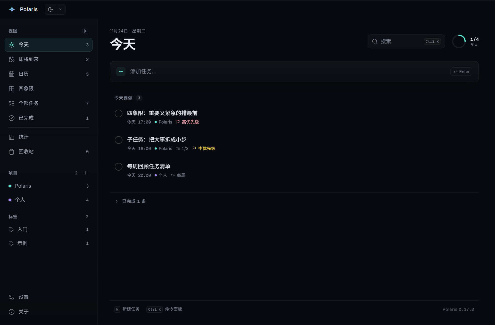
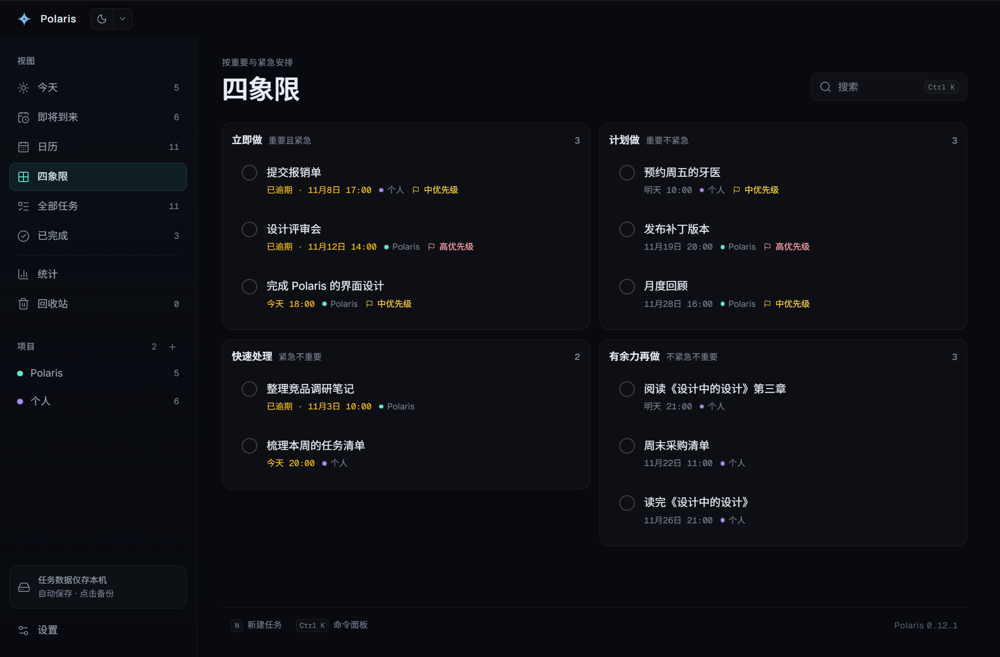
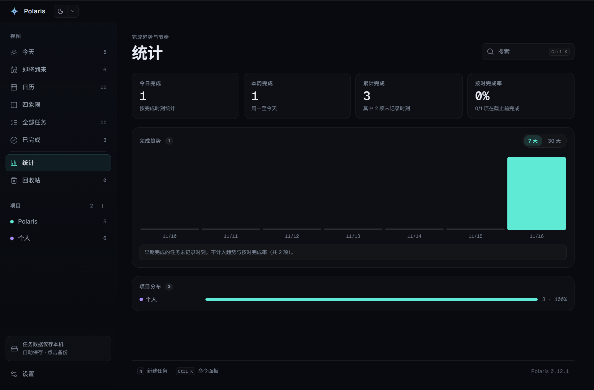
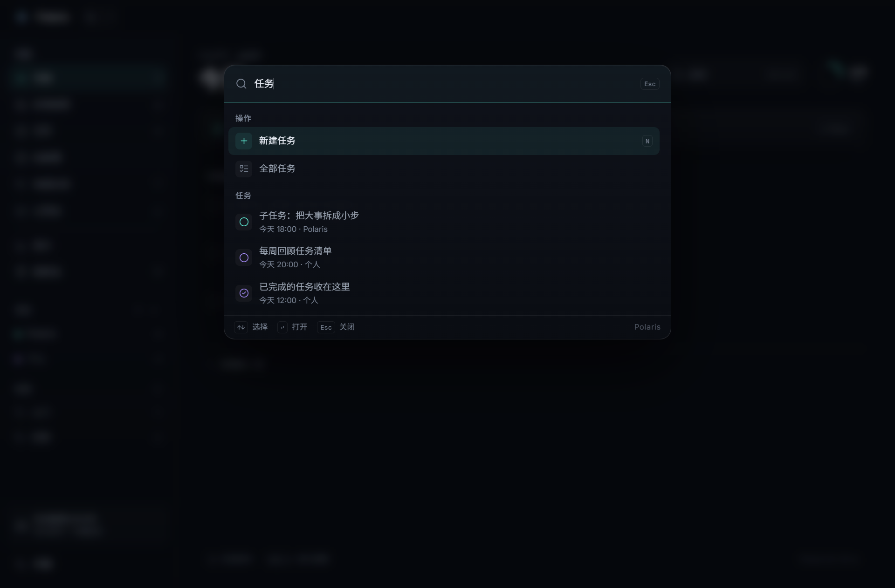
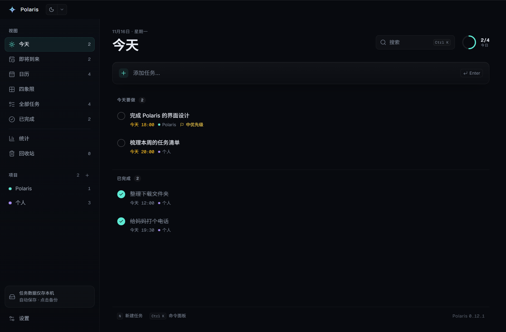
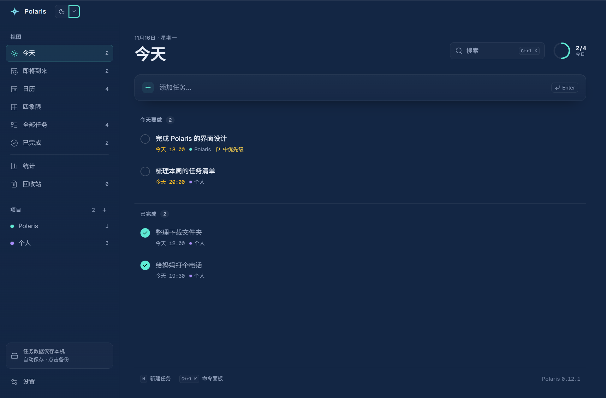
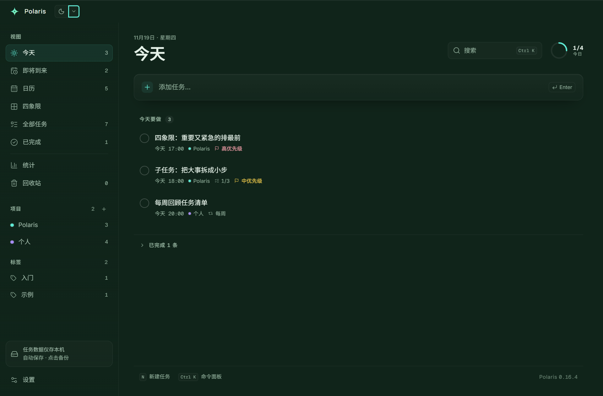
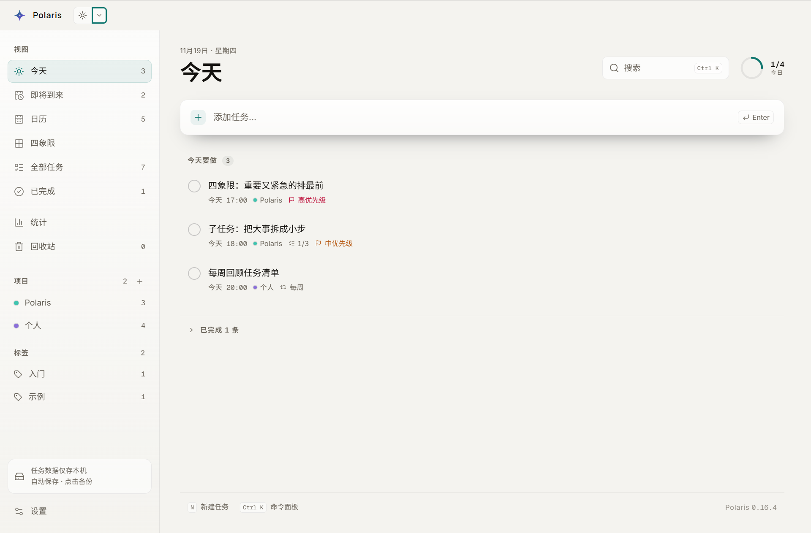

<div align="center">


 [](README.en.md)

# Polaris

**Windows 11 上的本地优先待办应用**

深色墨黑界面 · 青绿信号色 · 原生窗口控件 · 数据默认只保存在本机

[](https://github.com/2dapeng518/Polaris-Todo/releases/latest)
[](#安装)
[](LICENSE)
[](https://github.com/2dapeng518/Polaris-Todo/releases)

</div>

Polaris 面向 Windows 11 桌面，用 Electron 构建，数据落在本机 SQLite 文件里，不依赖账号，默认仅本地保存（数据目录可改存到网盘同步文件夹，由你自己的网盘客户端上云，见「数据存放位置」）。界面支持简体中文与英文，强调键盘操作、可访问性和安静的视觉层级：八个视图、自然语言快速添加、子任务与标签、提醒与重复、统计回顾，外加托盘驻留、全局热键和后台自动更新——装好之后几乎不用想起它，它一直在。

<div align="center">

</div>

## 安装

从 [GitHub Releases](https://github.com/2dapeng518/Polaris-Todo/releases/latest) 下载 `Polaris-Setup-<版本>.exe`：一键安装，双击即装进当前用户目录（`%LOCALAPPDATA%\Programs`），无需管理员权限，不选安装路径、不问确认，装完自动启动；安装提示为简体中文。

装好后应用会自己保持最新：启动后、每 4 小时、窗口重新聚焦或系统从睡眠唤醒时都会检查更新（聚焦/唤醒补查有 30 分钟节流，不会频繁打网），后台差量下载，点「立即重启」即静默安装并自动拉起新版，全程不弹安装向导；不点也没关系，下次正常退出时自动装上。也可以跳过某个版本（只是不再自动弹窗，更新仍会在退出时安装），或随时从托盘 / 设置页脚手动检查。

如果以前装过「所有用户」版本（位于 `C:\Program Files`），建议先在系统「设置 > 应用」里卸载旧副本再装新包：旧安装位置会让更新仍弹一次 UAC 确认，卸载迁移后才能全程无感。

> [!NOTE]
> 安装包未做代码签名，首次运行可能触发 SmartScreen 或杀毒软件扫描提示。应用图标来自 `build/icon.ico`，可用 `npm run make:icon` 重新生成。

## 功能一览

### 视图与组织

- **八个视图**：今天 / 即将到来 / 日历 / 四象限 / 全部任务 / 已完成 / 统计 / 回收站。侧栏按工作流分组——干活视图在上，统计与回收站用分隔线归入回顾区；支持项目与标签筛选、今日完成进度环。列表里的已完成区默认折叠成「已完成 N 条」一行，点击展开或收起，勾选完成只加计数不打扰当前列表；切换视图后回到折叠。
- **统计回顾**：今日完成、本周完成（周一起算）、累计完成与按时完成率，7 天 / 30 天完成趋势柱状图、各项目累计完成占比。全部数字在本地从任务列表派生，不额外存库；没有记录完成时刻的老任务计入累计与项目分布，但不计入趋势和按时率，界面会注明数量。
- **四象限**：按「重要 = 中/高优先级、紧急 = 今天到期或已逾期」把未完成任务派生进立即做 / 计划做 / 快速处理 / 有余力再做，2×2 卡片窄屏自动堆叠；无截止视为不紧急，跨午夜自动重新判定。
- **日历**：工具栏一键切换七个子视图——月 / 周 / 多周 / 日 / 多日 / 列表 / 看板，锚点日跨视图共享、切换不丢月份。
  - **月视图**：按截止时间把任务落到对应日子，周一起始、恒定 42 格翻月不跳高；每天最多直显三条，溢出收敛为 +N，**任务条按所属项目颜色着色**（浅底 + 左侧实色条，与侧栏项目彩点对应），逾期标警示色、已完成弱化划线，中高优先级带信号色圆点。月格完整键盘导航：方向键按日/周移动、Home/End 取本周首尾、PageUp/Down 翻月、Shift 组合翻年、Enter 打开当日首条任务。
  - **周 / 日 / 多日**：00–24 小时轴，任务按计划开始 / 结束时刻摆块（只有截止的任务按「截止 +1 小时」摆虚线视觉块），**块按所属项目颜色着色**（背景浅色 + 左侧实色条，与侧栏项目彩点一一对应，无项目任务保持信号色），重叠自动并排分列，顶部全天行收纳全天任务（同样带项目色），当前时刻红线；空白处拖拽即创建（拖多长建多长，15 分钟吸附）、拖块移动、拖下缘改时长，移动会带着截止一起走。多周视图是两张周历的紧凑日格。
  - **列表**：按日分组的议程——已过期 / 今天 / 明天 / 具体日期 / 无日期分区（无日期任务也纳入），行复用主列表的勾选与详情；已完成区默认折叠。
  - **看板**：无日期 / 已过期 / 今天起 7 天 / 更远的卡片泳道，卡片拖到某天列即改期（保留原钟点），拖到「无日期」清空日程。
  - **年月下拉与迷你月历**：月份标签点开即年月快速跳转；迷你月历可开关（记住选择），点日期全视图跟随。
  - **信息层（显示设置可开）**：月格农历日 / 节气 / 传统节日、法定节假日「休」与调休「班」角标（官方年度安排内置，未收录年份静默）、ISO 周数列；开关即时生效并记住。
  - **搜索与筛选**：工具栏直接搜标题，按项目或标签筛选（互斥），作用于全部子视图。
  - **打印**：工具栏一键打印当前视图——打印前自动切到亮色主题（省墨），侧栏 / 工具栏 / 快速添加等界面壳自动退场，纸面只留日历本体；打印结束主题自动恢复。
  - **天气与订阅日历不做**：两者都依赖持续联网与外部服务，与「本地优先、数据不出机器」的定位冲突，按 2026-11-25 拍板明确后置不排期；需要外部日历时可用上面的 ICS 导出作为桥。
- **项目与标签**：侧栏新建项目，内置六种配色；标签在详情里回车即创建并贴上，建议 chip 一键复用，侧栏按标签筛选（与项目筛选互斥），删除标签级联清理关联。
- **可收窄侧栏**：一键把侧栏收成 60px 图标栏（视图图标、项目彩点、标签首字），横向空间全让给任务区，选择会被记住；底部常驻「设置」入口，「关于」只保留设置窗口内的唯一入口（版本 / 许可 / 检查更新都在那里）。

### 任务编辑

- **快速添加自然语言识别（中英双语）**：输入「下周三下午3点交季度报告 #Polaris !高」或「Call mom tomorrow 3pm」，自动识别截止时间、项目和优先级，标题只留下「交季度报告」/「Call mom」。识别结果显示在输入框下方，逐个可撤销，输入框里的字一个都不会被改写。中英文语法与界面语言无关，两种界面下都生效。还能识别时间段——「3点到5点值班」会记下 15:00–17:00 的计划区间。详见[识别规则](#快速添加的识别规则)。
- **任务详情检查器**：宽屏是右侧内联列，关闭后自动收合给列表让位；窄屏是模态抽屉。标题和备注自动保存，截止、时间、提醒、重复用行内弹层编辑，Esc 保存并收起。日期时间用应用内自绘月历与分段时间字段，不走系统控件；移动截止时间会按原偏移一起搬动提醒。「时间」行可设计划开始 / 结束（结束不早于开始，自动保持时长）与全天标记；全天只看日期、忽略钟点，取消全天后恢复显示。
- **检查清单（子任务）**：详情底部的轻量步骤列表，回车连续添加，逐行勾选、行内改名、删除即时落库；任务行显示「2/5」式进度。子任务只有标题和完成态，父任务的完成与子任务互不联动。
- **提醒**：到点弹出右下角自绘提醒窗，可完成或稍后 10 分钟；退出期间错过的提醒下次启动补弹。
- **重复任务**：每天、工作日、每周、每月、每年；完成时保留当前实例并生成下一次，提醒按相对截止的偏移继承，子任务复制到新实例并全部重置为未完成，标签随实例继承。
- **删除撤销与回收站**：底部「撤销」保留 6 秒（悬停/聚焦暂停），也支持 `Ctrl Z`；软删除进回收站保留 30 天，可单条恢复，「彻底删除」与「清空回收站」都有二次确认，到期自动清除。
- **写失败提示**：保存、勾选、删除、撤销或读取失败时，底部出现错误提示并回滚未落库的改动，不会静默丢失；下一次成功读写后自动消失，也可手动关闭。

### 数据与集成

- **本地 SQLite**：数据位于数据目录下的 `polaris.db`（默认在 Electron `userData`，可在设置改为任意盘符 / 文件夹，见「数据存放位置」），WAL 模式，自动保存，默认仅本地。数据与备份的全部事实与操作集中在 设置 → 数据与备份：导出 / 导入、自动备份管理与数据存放位置。
- **JSON 备份**：设置里一键导出 / 导入全量备份（`schemaVersion: 4`，含子任务、标签关联与任务计划时间段）；v1 / v2 / v3 旧备份仍能导入，只是缺少对应数据。
- **自动备份与灾难恢复**：启动时与运行期每小时兜底检查，最新一份超过设定周期才往数据目录的 `backups/` 写一份 JSON 备份（原子写，保留最近 21 份，目录跟随「数据存放位置」）；周期在「管理…」对话框里可调（关闭 / 12 小时 / 24 小时 / 3 天 / 7 天），自动备份列表支持逐份合并导入（已存在的任务跳过，不覆盖当前数据）、另存到任意位置、逐份删除（带确认），也能一键打开数据目录；数据库文件损坏时改名隔离保留（含 WAL 旁车，绝不覆盖删除），重建新库并双语告知，不会静默丢数据死掉。
- **数据存放位置（可选，默认用应用数据目录）**：设置 → 数据与备份 → 数据存放位置，可把任务数据库（`polaris.db`）连同自动备份改存到任意盘符或文件夹——网盘同步文件夹也允许（活跃库被同步客户端直接同步有损坏风险，由你自担）。目标文件夹已含 `polaris.db` 时直接采用它：**重装软件后指回原目录即可加载全部历史数据**，主题、语言、MCP 访问令牌都随库恢复；空文件夹则把当前数据复制过去。确认后应用自动重启生效，自动备份目录跟随数据目录；退出时数据库自动收拢为单文件并记录指纹，下次启动会检测外部变更（多设备同步 / 异常退出）并双语提示——应用自身的切换 / 恢复默认复制会随写随记指纹，不构成外部变更、不会误报；「恢复默认」把当前数据复制回默认目录（默认目录里的旧库先备份让位）。位置记忆存在默认应用数据目录根的 `data-location.json` 指针文件里，不要手动删除它；指针指向的目录不可用时，启动会回退默认位置并双语告知，数据原样保留在原目录。日志、浏览器缓存等其他文件始终留在默认数据目录。
- **CSV 导出**：一键导出活任务为通用 CSV（规范列 + 项目 / 标签 / 缩进子任务 / 完成态，带 UTF-8 BOM，Excel 直接打开不乱码），供备份或搬出；重复规则、提醒、附件与评论不随 CSV 导出。导入 CSV 功能已移除（2026-11-19 拍板），搬入仅余 JSON 备份合并导入。
- **ICS 日历导出**：一键导出 RFC 5545 日历文件（.ics），有日期的任务成为 VEVENT（计划开始 / 结束成事件、全天任务带排他 DTEND、项目落 LOCATION、标签落 CATEGORIES、优先级按 RFC 映射、完成任务带 X 标记），可导入 Google Calendar / Outlook 等日历应用或做订阅源；提醒、重复规则、子任务与回收站任务不随 ICS 走。导入 ICS 不在范围内（单向出口，与 CSV 同定位）。
- **本地 MCP 服务**：设置里可开启（默认关），在 `http://127.0.0.1:3737/mcp` 提供 MCP Streamable HTTP 端点，AI 助手可直接列出 / 新建 / 更新 / 完成 / 删除任务、查项目与标签。八个工具直调与界面完全相同的落库逻辑，零逻辑复制。客户端必须携带 `Authorization: Bearer <token>` 请求头——token 首次启用时自动生成（`sk-` 前缀），在 设置 → 本地 MCP 服务 里以自适应短掩码展示（头尾 hex 位数随盒宽自适应、保底头 4 尾 4、封顶头 12 尾 12，中段至少藏 37 位），掩码盒按内容收窄、用法说明吃中间余宽、与复制 / 重置按钮同一行，一键整串复制，重启不变；「重置」会立即作废旧 token。0.16.1 及以前的无前缀旧 token 升级后继续被接受，已配置的客户端不用重配；只有新生成 / 重置的 token 带前缀。页面下方还按客户端（Claude Code / Cursor / VS Code / Codex）提供可一键复制的配置片段，端点与令牌自动填好；片段里的令牌在屏幕上以前四后四的短掩码展示，复制时才写入完整值。

> [!IMPORTANT]
> MCP 只绑本机回环地址，并要求 bearer token 鉴权：缺失或错误的 token 一律 401，本机其他进程拿不到 token 就读写不了任务。token 仅存本机数据库、不进备份文件，MCP 读写只发生在本机，服务随应用运行、退出即停。
> **升级注意（breaking）**：0.15.0 之后的版本启用了 token 鉴权，已有的 MCP 客户端配置需要补上 `Authorization: Bearer <token>` 请求头才能继续访问。

### 桌面体验

- **托盘驻留**：关闭主窗口后驻留系统托盘，提醒继续运行。托盘菜单四项：打开 Polaris / 设置 / 检查更新 / 退出；手动检查更新永远给答复（气泡提示），只有发现更新才唤起主窗口。
- **快捷键列表（可自定义）**：设置 →「快捷键」页是键帽式列表——一行一个快捷键，按键画成键帽，点右侧铅笔即可改键。含全局快速添加（默认 `Ctrl+Alt+P`，任何程序里按一下唤起 Polaris、回「今天」并聚焦快速添加，可关闭）、应用内快速添加 `N`、命令面板 `Ctrl+K`、撤销 `Ctrl+Z`，以及视图导航 `Ctrl+1–8`（今天/即将到来/日历/四象限/全部/已完成/统计/回收站；默认带 Ctrl 防误触，可改回裸键）。改键即时生效并记住；全局组合被别的程序占用时，换一个空闲组合即可当场治好。
- **开机自启**：登录 Windows 后以 `--hidden` 后台启动到托盘；单实例保护，再次启动唤起已有窗口。
- **在线更新**：GitHub Releases 渠道，后台差量下载（blockmap），下载进度显示速度、已下载 / 总量与剩余时间——速度 / 剩余时间行常驻占位，数值忽隐忽现弹窗不抖；下载满 100% 后的校验间隙在槽里落「校验安装包」文案；更新说明富文本渲染（DOMPurify 消毒）；「跳过此版本 / 稍后 / 立即重启」三种选择，点重启先落「正在重启」反馈再退进程，默认焦点在「稍后」，Enter 不会误重启。
- **启动动画**：约 2 秒的品牌动画——光点汇聚成四角星、星点亮、轨道环行进、字标落定；主题跟随上次选择、首帧即正确配色。主界面等动画播完、启动页完全退场后才显示——两者不同屏，无白屏闪烁、无空帧。后台自启不显示。
- **六套主题**：三深三浅按色系成对（夜阑↔昼白、暮蓝↔天蓝、松墨↔暖砂），标题栏分体式开关一击深浅互换，详见[主题](#主题)。
- **小屏适配**：窗口默认与最小尺寸贴合屏幕工作区，分辨率变化时自动重收；1024×576 级别小屏走紧凑布局，侧栏导航独立滚动，设置与关于入口钉底不丢。
- **独立设置窗口**：设置不再是主界面里的浮层，而是一扇独立小窗——左侧分类导航（外观 / 常规 / 快捷键 / 数据与备份 / 本地 MCP 服务），「关于」钉在导航末尾，右侧只显示当前分类。它是主窗口的子窗口（始终盖在主窗口上方、非模态，可以开着设置同时干活），单例不叠第二扇，Esc 关窗，托盘「设置」与侧栏按钮打开的是同一扇。
- **界面语言**：设置窗口「外观」页可在简体中文 / English 之间切换，界面文字、日期格式与托盘菜单立即更新并记住选择；系统通知与原生文件对话框同步使用当前语言。
- **键盘优先与无障碍**：命令面板（`Ctrl K`）与窄屏详情有焦点陷阱，宽屏详情保持列表可操作；支持 skip link、reduced motion；全应用十处输入框统一柔和聚焦语言（淡边 + 浅光晕），焦点环绝不与填充同色。
- **设置窗口收纳**：一页只放一个分类，无需在一屏里塞下全部；外观页的六张主题小卡（色样 + 名字，气质在悬浮提示）窄窗自动折成两行三列；令牌自适应短掩码（头尾各随盒宽自适应、保底头 4 尾 4、封顶头 12 尾 12，中段至少藏 37 位）按内容收窄居左、用法说明吃中间余宽、复制 / 重置贴右缘同一行；备份按钮行 2×2 网格、钮内文字永不折行；自动备份列表住「管理…」模态对话框，开关对话框不动页面布局；关于页带星标与版本号、检查更新与状态行、字体 / 图标署名和「打开声明目录」；窗口保留 Windows 原生最小化 / 最大化 / 关闭按钮。
- **关于与署名**：版本号在设置窗口「关于」页的品牌行；显示 MIT 许可与字体 / 图标署名，可一键打开声明目录；完整第三方组件与字体声明随安装包放在 `resources/NOTICE` 与 `resources/licenses/`。

## 界面预览

| 任务详情检查器 | 日历视图 |
|---|---|
|  |  |

| 四象限 | 统计回顾 |
|---|---|
|  |  |

| 设置窗口 | 命令面板 |
|---|---|
|  |  |

## 主题

六套颜色主题，三深三浅、按色系成对，每对一深一浅：

| 深色 | 浅色 | 气质 |
|---|---|---|
| 夜阑 `dark` | 昼白 `light` | 冷墨夜色 ↔ 暖瓷白昼（经典中性） |
| 暮蓝 `dusk` | 天蓝 `sky` | 深邃蓝调 ↔ 晴空天蓝 |
| 松墨 `green` | 暖砂 `sand` | 松墨夜色 · 沉静护眼 ↔ 燕麦暖砂 · 柔和白昼 |

- 标题栏是一枚**分体式开关**：左段一击在配对间往返（连点两次必回原主题），右段箭头展开六选一菜单；设置窗口「外观」页的六张主题卡同样任选（名字上卡面，气质在悬浮提示里），命令面板另有「主题：夜阑」等六条直达命令。
- 切换立即生效并记住：支持 View Transitions 时做一次约 200ms 的柔和淡变，reduced-motion 下直接切换；首次启动跟随系统浅色 / 深色偏好。
- 青绿信号色全主题统一，画布各有气质，文字对比度均达 WCAG AA（`npm run verify:themes` 持续校验）。

每列一对，上深下浅：

| 夜阑 ↔ 昼白 | 暮蓝 ↔ 天蓝 | 松墨 ↔ 暖砂 |
|---|---|---|
|  |  |  |
|  |  |  |

## 快捷键

| 快捷键 | 作用 |
|---|---|
| `N` | 聚焦快速添加（统计 / 四象限 / 日历 / 回收站里路由回「今天」） |
| `Ctrl Alt P` | 全局热键：任意程序里唤起 Polaris、回到「今天」并聚焦快速添加（设置里可自定义与关闭） |
| `Ctrl K` | 打开命令面板：搜索任务、切换视图、新建任务或项目、快切主题 |
| `Enter` | 保存快速添加 / 打开选中项 |
| `Tab` | 从快速添加走到识别标签 |
| `Backspace` | 在识别标签上取消该项识别 |
| `Esc` | 清空快速添加草稿；或保存并收起详情，或关闭命令面板 / 弹层 / 确认弹窗 |
| `Ctrl Z` | 撤销最近一次删除（输入框内保留文字撤销） |

## 快速添加的识别规则

在快速添加里直接写日期、时间和 `#项目`、`!优先级`，识别结果会以可点击的标签显示在输入框下方。**输入框的文字始终原样保留**，点标签只是取消这项识别，被取消的文字会回到标题里。

### 支持的写法

| 类别 | 例子 |
|---|---|
| 相对日 | 今天、明天、后天、大后天、今儿、明儿 |
| 相对日 + 时段 | 今晚、明早、明晚、后晨 |
| 星期 | 周三、下周三、本周五、下下周一、星期天、礼拜天、周3、下个星期三 |
| 月日 | 11月20日、11月20号、十一月二十日、2027年1月5日 |
| ISO 日期 | 2026-11-20 |
| 中文钟点 | 下午3点、三点半、十点一刻、两点钟、10点15分、凌晨2点 |
| 中文时间段 | 3点到5点、下午3点到5点半、晚上11点到凌晨1点、10:00-11:30 |
| 24 小时制 | 15:00、下午3:00 |
| 裸时段 | 上午、中午、下午、晚上、傍晚、凌晨、早上、早晨 |
| 截止后缀 | 明天前、周五之前、今天之内 |
| 英文相对日 | today、tonight、tomorrow、day after tomorrow（简写 tmr、tmw） |
| 英文星期 | friday、fri、next friday、this friday、on friday |
| 英文时刻 | 3pm、3:30pm、3 pm、at 3、noon、midnight、morning、afternoon、evening |
| 英文时间段 | 3pm to 5pm、3pm-5pm、10:00 to 11:30（终点不写 am/pm 继承起点） |
| 英文偏移 | in 2 hours、in 30 minutes、in 3 days、in 2 weeks |
| 英文月日 | dec 25、december 25、25 dec、12/25、jan 5 2027（月/日按美式） |
| 项目 | `#Polaris`（匹配已存在的项目，不区分大小写，最长名称优先） |
| 优先级 | `!高` `!中` `!低`，或 `!3` `!2` `!1`，或 `!high` `!medium` `!med` `!low` |

全角的 `＃` `！` `：` 和全角数字会按半角处理。日期与时间可以分开写，「明天 交报告 下午3点」同样有效。英文与中文语法可以混写，「明天 3pm 开会」也能识别。

### 只认开头和结尾

日期只有出现在**开头一簇**或**结尾一簇**才会被识别。「把下周三的报告提前」里的「下周三」在句子中间，不会被吃掉。开头允许「记得 / 别忘了 / 提醒我 / 安排一下」这类提示词，它们本身留在标题里。

### 时间是怎么定的

- 只写日期不写时间 → 当天 23:59:59，标签只显示日期和星期。
- 写了钟点 → 用该时刻。「今晚8点」按 20:00 理解。
- 只写时段（「晚上买菜」）→ 用默认时刻（凌晨 5、早上 7、上午 9、中午 12、下午 15、傍晚 18、晚上 20），标签会标明时间是推断的。若该时刻已过且日期是明确的，就退回当天 23:59:59，不显示编造的时间。
- 裸小时 1–6 点按下午理解（「3点开会」= 15:00）；但如果结果落在今天且上午读法还没过去，就用上午（凌晨 5 点说「6点起床」= 今天 06:00）。19 点说「6点起床」会得到明天 18:00——这是这条启发式的已知边界。
- 没有日期只有时间且时刻已过 → 顺延到明天，标签会明写「明天」。
- 有明确日期时绝不顺延：16 点说「今天下午3点」就是已逾期，标签如实显示。
- 什么都没识别出来 → 沿用原来的视图默认值（今天视图 23:59，即将到来视图次日 09:00，其余无日期）。
- **时间段（区间）**：「3点到5点」这类写法识别为计划开始 / 结束时刻（`startAt` / `endAt`），截止与开始同刻，区间不再留在标题。两侧沿用同一套钟点规则（裸 1–6 点按下午理解）；终点不晚于起点时顺延一天（「晚上11点到凌晨1点」= 23:00 到次日 01:00）；「今晚8点到10点」的弱时段会同样作用到终点。区间里的时间在日历周 / 日视图里摆成时间块。混写两侧（如「3点到17:00」）与开头/结尾锚定规则不变——不在头尾的区间不会被吃掉。

### 英文写法

英文语法与界面语言无关：中文界面里输入「tomorrow 3pm」同样生效，英文界面里也照样认「明天」。

- 只写日期不写时间（`tomorrow`、`dec 25`）→ 当天 23:59:59，与中文一致。
- 只写时段（`morning`、`afternoon`、`evening`）→ 默认时刻分别是 09:00、15:00、20:00，对应中文的上午/下午/晚上，标签标明时间是推断的。`tonight` 按 20:00，`noon` 12:00，`midnight` 次日 00:00。
- `3pm`、`3:30pm`、`3 pm`、`at 3` 都认；不带 am/pm 的 `at 3` 与中文裸小时同一套启发式（1–6 点按下午理解）。
- `in 2 hours`、`in 30 minutes`、`in 3 days`、`in 2 weeks` 直接按当前时刻加偏移，标签显示精确时刻。
- `next friday` 是下周的周五（对齐「下周五」）；`this friday` 若本周已过则整段不识别、文字留在标题里（对齐「本周五」）；裸 `friday` 取最近的将来周五。
- 缩写既是星期词也是普通词：裸 `sat`/`sun`/`mon` 只在像日期时才消费（小写且后面不跟普通单词、前面不是代词），`Sat down`、`Sun Microsystems`、`SAT scores`、`Mon ami` 都原样保留。星期词带了 `next`/`this`/`on` 才放宽。
- 月份名必须紧挨着日号才算日期，`May the force be with you`、`march forward`、`April is nice` 不会被当成日期；`good morning` 这类问候整体不识别。
- 英文日期同样只认开头簇和结尾簇：「call mom on friday please」中间的 `friday` 不动。

<details>
<summary><b>刻意不识别的写法</b>（避免把标题里的字误当成日期）</summary>

下面这些一律不解析：

- 过去向：昨天、前天、上周三、去年
- 重复语：每天、每周三、每月15号、工作日（重复请用详情栏的重复规则）
- 数量词：下周三个人来面试、本周三场比赛、一周三次、5点半价门票
- 序号与量词：第3点、3点注意事项、2点建议、3点方向
- 区间：周一到周五、3点到5点、15:00到17:00
- 模糊与相对时长：3天后、半小时后、10点差5分、10点左右、上午10点光景
- 小数点：沪指涨1.5点
- 省略形式：15号、11月、11/20、11.20、2026-11-20T15:00
- 专名与固定词：周六福、周一围、下午茶、早上好、今日头条、明早期瓷器、下周日程、今日志导出
- 纯数字标签：`#123`、`issue#123`、`C#开发教程`

`#项目` 找不到同名项目时，会显示一条不可点击的提示「未找到「X」」，文字留在标题里；存在多个同名项目时不猜，提示「有 N 个「X」，未指定项目」。

</details>

<details>
<summary><b>日期时间选择器与键盘操作</b></summary>

截止与提醒弹层里是 Polaris 自己的月历，不是系统弹窗。上方是快捷 chip，中间月历，下方一行时间凹槽（时 : 分 + 中文时段词）与 ±15 分钟按钮。清空日期请用「清除截止时间」按钮。

| 按键 | 作用 |
|---|---|
| `←` `→` | 前后一天 |
| `↑` `↓` | 前后一周 |
| `Home` `End` | 本周周一 / 周日 |
| `PageUp` `PageDown` | 前后一月 |
| `Shift PageUp` `Shift PageDown` | 前后一年 |
| `Enter` `Space` | 选中该日并跳到时间字段 |

时间字段里直接打数字：「1830」四键成事，「9」单键也成事；小时打满会自动跳到分钟。`↑` `↓` 在本字段内 ±1 并回绕（23→00、59→00），`Shift ↑` `Shift ↓` 与 ±15 按钮等价，整体移动 15 分钟且当天内不跨日。`Home` `End` 取本字段最小/最大值，`Enter` 提交并收起弹层。

月历上三种状态形状不同：选中日是实心青绿，今天是青绿描边加下方圆点，未设置时的草稿日是青绿虚线框。「今天」按钮不会把时间设到过去——若当前时刻已过，会顺延到下一个 5 分钟整点。

**识别条的键盘与无障碍**：`Tab` 从输入框走到「保留为文字」再走到各个标签，`Enter` 或 `Backspace` 取消识别，`Esc` 清空整条草稿。用键盘取消识别后焦点留在识别条内，不会跳回输入框。「明天下午3点」这类只有日期没有任务名的输入会拦下 `Enter`，并通过屏幕阅读器播报「还差一个任务名」。中文输入法组词期间 `Enter` 不会提交。

</details>

## 技术栈

| 类别 | 技术 | 版本 |
|---|---|---|
| 运行时 | Electron | 45.3（Chromium 156 / Node 24） |
| 构建 | electron-vite / Vite / TypeScript | 6.0 / 8.3 / 7.0 |
| 界面 | React / Tailwind CSS / Motion / Zustand | 19.3 / 4.3 / 14.12 / 5.1 |
| 数据 | better-sqlite3 / rrule / zod | 13.0 / 2.8 / 4.6 |
| 更新 | electron-updater / DOMPurify | 6.8 / 3.4 |
| 日志 | electron-log | 5.4 |
| 打包 | electron-builder（NSIS） | 26.18 |
| 图标与日期 | lucide-react / date-fns | 1.72 / 4.4 |

字体：Manrope（标题）、Inter（正文）、Noto Sans SC（中文）、Geist Mono（数字与时间）。

## 架构

```text
┌────────────────────────────────────────────────────┐
│ Renderer（React 19 + Zustand + Motion）             │
│ 视图 / 详情 / 命令面板 / 提醒窗 / 设置 / 更新弹窗     │
└───────────────────┬────────────────────────────────┘
                    │ window.polaris（preload contextBridge）
┌───────────────────▼────────────────────────────────┐
│ Main（Electron 45）                                 │
│ IPC + zod · SQLite · 提醒调度 · 托盘 · 自启          │
│ 全局热键 · 在线更新 · 本地 MCP · 启动页               │
└────────────────────────────────────────────────────┘
```

- 主进程负责窗口生命周期、SQLite、提醒调度、托盘、开机自启、全局热键、在线更新与本地 MCP；渲染层运行在 `contextIsolation` + `sandbox` 中，不直接访问 Node。
- `src/preload/index.ts` 通过 `contextBridge` 暴露类型化的 `window.polaris`；数据类 IPC 参数在 `src/main/ipc.ts` 用 zod 校验。
- `src/shared/` 放主进程与渲染层共用的类型、主题注册表、重复规则计算、快速添加解析与 CSV 导出，避免两端各写一套。
- 数据库位于 Electron `userData/polaris.db`，WAL 模式；任务采用软删除，撤销与回收站恢复时还原，保留期规则在 `src/shared/retention.ts`。
- 提醒窗复用同一个渲染入口，通过 `#/reminder/<taskId>` 加载 `ReminderView`；启动页是第二个渲染入口 `splash.html`，主题与版本号由主进程注入，首帧即正确配色。
- 更新状态单向流动：主进程经 `update:state` 推送快照（全应用唯一的 push 通道），渲染层不自行推导进度。
- 渲染层没有路由，视图、项目筛选、选中任务和命令面板状态都由 Zustand 管理。

更细的模块边界和修改注意事项见 [CLAUDE.md](CLAUDE.md)。

## 快速开始（开发）

前置条件：

- Windows 11（目标平台）
- Node.js 与 npm（开发环境验证：Node 26.13 / npm 11.20）

```bash
npm install
npm run dev
```

> [!TIP]
> 如果安装后 Electron 二进制缺失（npm 11 默认阻止生命周期脚本），补跑 `node node_modules/electron/install.js`。`package.json` 的 `allowScripts` 已列出需要安装脚本的依赖。

常用命令：

| 命令 | 作用 |
|---|---|
| `npm run dev` | 启动 electron-vite 开发服务器 |
| `npm run typecheck` | 主进程 + 渲染层 TypeScript 检查 |
| `npm run build` | 构建到 `out/` |
| `npm run smoke` | 启动真实应用跑冒烟测试（需先 `npm run build`） |
| `npm run verify:themes` | 主题对比度与注册表不变量校验 |
| `npm run verify:datetime` | 日期时间纯函数不变量校验（「今天」不落过去等） |
| `npm run verify:pure` | 快速添加解析 + 回收站保留期真值表校验（纯 Node，不启动 Electron） |
| `npm run preview` | 预览生产构建 |
| `npm run build:win` | 构建并生成 NSIS 安装包（`--publish never`，不上传） |
| `npm run build:mac` | 构建并生成 macOS 安装包 |
| `npm run release:win` | 构建并发布到 GitHub Releases（需 `GH_TOKEN`） |
| `npm run make:icon` | 重新生成应用图标（png/ico/icns）与托盘图标 |

开发时关闭主窗口只会隐藏到托盘；结束 `npm run dev` 请用托盘菜单「退出」或 `Ctrl+C`。首次启动会创建数据库并写入一组教学示例任务：每条演示一个功能（快速添加、子任务、标签、重复、提醒、四象限、完成区、时间段、全天、跨天、日历信息层、打印），用法写在备注里；之后随时可在 设置 → 数据与备份 →「载入示例」重新合并最新示例集（按固定 ID 幂等：已有示例跳过、只补新增，绝不覆盖现有数据）。

## 目录结构

```text
src/
  main/        Electron 主进程、SQLite、IPC、提醒、托盘、自启、热键、更新、MCP
  preload/     contextBridge API
  shared/      共享类型、主题注册表、重复规则、快速添加解析、CSV 导出
  renderer/
    index.html
    splash.html    启动页（独立小窗入口）
    src/
      components/  视图、详情、命令面板、提醒窗、设置、更新弹窗、提示条
      lib/         日期格式化、统计派生、焦点陷阱
      stores/      Zustand 状态
      styles/      单一样式表 globals.css
scripts/       冒烟测试启动器、主题/日期/纯函数校验脚本、图标生成脚本
design-system/ Polaris 品牌系统、token、组件规范
build/         应用图标与安装包资源
```

## 开发流程

当前仓库以 `main` 为主分支，已配置基础 CI（typecheck + 主题/日期/纯函数校验，见 `.github/workflows/ci.yml`）。推荐的本地流程：

1. 改代码，用 `npm run dev` 验证交互。
2. 运行 `npm run typecheck`。
3. 运行 `npm run build && npm run smoke`；动过主题加跑 `npm run verify:themes`，动过 `lib/dateTime.ts` 加跑 `npm run verify:datetime`，动过 `shared/quickAddParse.ts` / `shared/retention.ts` 先跑秒级的 `npm run verify:pure` 快速反馈。
4. 需要看视觉结果时，先 `POLARIS_HARNESS=1 npm run build` 带 harness 重建（生产构建会剥离截图代码，直接截会静默无产出），再 `POLARIS_SHOT=<mode> npx electron .` 截图到仓库根目录（模式清单见下方折叠块）；截完跑一次 `npm run build` 恢复生产态；验证时请加 `--user-data-dir` 隔离，避免改写真实配置目录的主题。英文界面截图加 `POLARIS_LOCALE=en`（首启种子与截图选择器随语言切换），归档在 `docs/screenshots/en/`，供 `README.en.md` 引用。
5. 发布：递增 `package.json` 版本 → 提交并打附注 tag → **先 push main 与 tag**（否则 electron-builder 可能抢先把 tag 建在旧 HEAD 上）→ 设好 `GH_TOKEN` 跑 `npm run release:win`。发完核对 Release 资产三件套齐全：`Polaris-Setup-<版本>.exe`、`.blockmap`、`latest.yml`（electron-builder 上传偶有静默漏传，缺啥用 `gh release upload --clobber` 补）；Release 若停在 DRAFT 用 `gh release edit --draft=false` 转正。

<details>
<summary><b>POLARIS_SHOT 截图模式清单</b></summary>

模式包括 `detail`、`palette`、`projects`、`reminder`、`reminder-detail`、`settings` / `settings-general` / `settings-data` / `settings-mcp` / `settings-about`（各开设置窗口对应分类页，MCP 那张会临时启用服务拍令牌行再恢复）、`sidebar-collapsed`（收起侧栏）、`theme-menu`、`palette-theme`、`toast`、`recurrence`、`parse`、`parse-past`、`parse-notice`、`parse-blocked`、`due-picker`、`due-clear`、`trash` 及各自的 `light-` 变体，另有仅深色的 `trash-confirm`（回收站的彻底删除确认弹窗）、`narrow`（先把窗口缩到 1100×800 再截详情栏）、`calendar`（自种八条散布当月的任务，含逾期与一条已完成，截完硬删清场）、`matrix` 与 `stats`（用首启示例数据截四象限与统计），以及 `themes`（逐套截取六主题主视图、展开的主题菜单与主题选择器）、`splash`（逐六主题截取启动页，不触碰主窗口主题）。回收站截图会自种两条已删任务、截完硬删清场。README 里的截图归档在 `docs/screenshots/`。

</details>

打包产物：

- `dist/Polaris-Setup-<版本>.exe`：NSIS 一键安装包，装进当前用户目录，无需管理员权限，装完自动启动。
- `dist/Polaris-Setup-<版本>.exe.blockmap` 与 `dist/latest.yml`：在线更新的差量下载与版本元数据，发布时随安装包一起上传。
- `dist/win-unpacked/Polaris.exe`：免安装目录版。
- 另提供 `npm run build:mac`（macOS 打包配置，图标 `build/icon.icns`）；主要目标平台仍是 Windows 11。

## 测试

仓库没有 vitest/jest 之类的单元测试框架，也没有 lint 脚本。自动化检查是冒烟测试、主题校验、日期时间校验与纯函数快速校验：

```bash
npm run build
npm run smoke
npm run verify:themes
npm run verify:datetime
npm run verify:pure
npm run check:brands
```

- **品牌词守卫**（`npm run check:brands`，pre-push 钩子与 CI 双重执行）扫描已跟踪文件、全部提交说明、tag 说明与历史 blob，命中受保护品牌词即失败；关键词以编码形式存放，守卫脚本自身不含明文字样。
- **冒烟测试**（`scripts/smoke.mjs`）启动真实 Electron，通过 `webContents.executeJavaScript` 驱动界面，166 条具名断言覆盖从快速添加到在线更新的全链路；使用临时 userData 配置目录，不碰本机数据，失败时以非零退出码结束并单独打印 `POLARIS_SMOKE_FAILED ["断言名", …]`。
- **主题校验**检查六套主题的 WCAG 对比度、注册表不变量与跨家族配对。
- **日期时间校验**直接 import 渲染层纯函数并注入时钟，用字面量期望表加全天 5760 个真实时刻扫描，再覆盖 7 个时区 2026 年的每一次夏令时跳变（共 17280 个真实时刻），钉死「今天」按钮不落过去这类靠跑 UI 撞概率的边界。
- **纯函数快速校验**（`npm run verify:pure`，CI 已挂）不启动 Electron，直接在 Node 里 import `shared/quickAddParse.ts` 与 `shared/retention.ts`，秒级跑完与冒烟 harness 同源的中文/英文解析真值表、误报反例、撤销状态机与保留期边界表；两处断言表需同步维护（`src/main/harness/assertions.ts` 的原断言保留，E2E 仍跑）。

期望值全部写成字面量，不经过被测函数自算；跨进程等待一律走条件轮询而非固定延时。高度断言用亚像素矩形，smoke 以 CDP 仿真 125/150/200% 显示缩放与 1024×536 低分辨率视口；段宽、分隔线、小字号中文等细节仍靠手动。视觉检查通过 `POLARIS_SHOT` 截图完成（需先带 harness 重建，见开发流程第 4 步），截图和冒烟测试需在本地运行。

<details>
<summary><b>断言覆盖明细</b></summary>

**主链路**：快速添加、详情编辑、完成、删除与撤销、命令面板、主题切换、主题菜单、开机自启、重复任务、「已创建下一次」提示、写失败提示和回收站全链路（删除进回收站、恢复回主列表、彻底删除的确认弹窗与 Esc 取消、清空回收站、空状态文案）。写失败可见性通过临时摘掉 `tasks:update` / `tasks:delete` / `tasks:restore` / `tasks:list` / `tasks:delete-forever` 通道制造真实落库失败，验证错误提示文案、乐观回滚、撤销失败后撤销按钮仍在、重试成功或手动关闭后提示清除；恢复时装回生产同一组 IPC handler。回收站的保留期边界（null / 29 天 / 恰好 30 天 / ±1 毫秒 / 非法 / 未来）由 `runRetentionAssertions()` 用字面量期望表钉死，`deletedAt` 字段链验证新建为空、软删盖章、恢复清空。

**检查清单**：详情里添加 / 勾选 / 行内改名 / 删除、任务行进度与详情进度的字面量、重新读库确认持久、重复任务新实例重置而旧实例保留、彻底删除父任务后子任务清空，以及 v2 备份带回子任务、v1 旧备份缺少 `subtasks` 字段时仍能导入。

**标签**：详情建标签贴标签、任务行 chip、侧栏计数与筛选命中数、删标签级联清 chip、重复任务新实例继承标签，以及 v3 备份带回标签与关联、v1/v2 旧备份仍能导入。

**数据存放位置**：空目录复制（在线一致性备份 + 自动备份目录跟随 + 指针落盘 + 会话仍留默认位置）、已有库采用（不覆盖不复制、备份目录不跟随）、pendingRestart 状态行替换文案、恢复默认入口按自定义状态出现、确认框取消零副作用（磁盘指针原样）、同路径与文件路径拒绝、未自定义时恢复默认无操作；重启生效本身不经冒烟（单进程），由手动验收覆盖。

**四象限**：命令面板直达、四条自种任务分落四象限的归属字面量、象限标题顺序、计数徽标与渲染行数自洽、点任务行开详情。

**CSV 导出**：纯函数真值表（契约表头、RFC4180 escaping、INDENT 缩进子任务、优先级四档映射、本地墙钟、回收站过滤、导出全文逐字相等）；冒烟另在主进程侧用夹具逐行字面量比对导出文本。

**日历**：命令面板直达、42 格、任务按截止落格、无截止不进日历、翻月标签与格数、今天按钮回本月、chip 点开详情。

**本地 MCP**：真实 HTTP 往返（经 IPC 取 bearer token）——initialize / tools/list / 建任务 / 列任务 / 完成任务 / GET 回 405 / 无 token 与错 token 401 / 重置后旧 token 401、新 token 200 / 关闭后拒连；token 形状钉死 `sk-` 前缀 + 64 位 hex、重复读取同值。

**在线更新**：纯函数真值表、开发态手动检查答 unsupported 且不弹窗、合成快照驱动发现→进度→就绪→稍后不再弹→跳过后再推保持安静、跳过持久化与页脚重开、HTML 更新说明富文本渲染（注入 `<script>` 被消毒不执行）、开发态安装守卫报错不杀进程、更新弹窗零抖动守卫（速度 null→有值→null→100% 校验四档快照面板顶边与高度零位移、校验文案落槽、点重启先落「正在重启」反馈且守卫报错不杀进程、带错误快照把按钮重置回可点）。

**托盘与热键**：构建后菜单标签恰为四项、托盘「设置」唤起主窗口并打开设置窗口、手动检查七态气泡文案真值表、开发态检查不弹窗不唤窗；热键默认开启（含自定义组合 meta 缺省断言）、设置往返、冲突降级中文提示、全局改键守卫（探测空闲组合经列表铅笔内联录制换绑落库、默认组合被占的机器上也走得通，收尾还原默认）、视图导航守卫（按 2/3/1 侧栏 active 视图跟随）、应用内改键守卫（view-today 1→9 落库 + focus 重拉生效 + 冲突拒绝 + 还原）、隐藏窗口唤起回「今天」并聚焦输入。

**布局与聚焦**：设置窗口守卫——最小窗档（720×520）× 中英双语 × 六个分类页横向零溢出，MCP 启用最坏态量令牌掩码形状（前缀 + 头尾各 k，4≤k≤12 封顶）、中段隐藏、盒按内容收窄、说明槽居中、复制 / 重置贴右缘同行；布局守卫量左导航右内容、六个分类、「关于」钉导航末尾、关于页版本号与主进程一致；生命周期守卫量单例（侧栏两入口不叠第二扇）、「关于」把已开窗口切页、Esc 关窗、关后能再开；侧栏收窄守卫量 60px 图标栏、文字视觉隐藏但无障碍名称仍在、收起态 title 提示、展开按原宽复位；CSV 守卫钉导出 CSV 独立成钮（四钮 2×2、无分体箭头与浮层残留），并在主进程侧用夹具逐行字面量比对导出文本（escaping/INDENT/优先级/墙钟/完成态）；低分辨率 1024×536 紧凑档生效且侧栏/主区不溢出；页脚钉底守卫以 40 条夹具量顶 / 中 / 底三态滚动状态栏底缘恒钉主区底缘减底 padding（sticky 钉底、滚到底回流零跳变，长列表不再滚丢快捷键提示与版本）；中段滚动时列表行在状态栏上方 40px 条件渐隐带溶进背景（仅下方仍有未滚完内容时点亮，滚到底 / 短内容关闭，resting 态与归档像素不变），守卫同量三态渐隐 opacity 顶 / 中 =1、底 =0；顶边锚定守卫在 1280×843 档验开 / 关关于对话框时面板顶边、页脚顶边、外框高度、内容高度与内容宽度逐像素零位移（对话框零增高契约）；焦点环扫描覆盖主视图、详情栏、日期弹层、主题菜单展开、回收站确认弹窗五种状态，任何环与自身填充/边框同色即失败。

**主题**：配对快切连点两次回到原主题（三对逐一校验）、六套主题矩阵的 `data-theme` / 持久化 / 令牌生效、标题栏主题菜单（六行齐全且顺序固定、打开即聚焦当前行、点选落库、菜单卸载后 `aria-expanded` 归位、焦点回到箭头、Esc 只收菜单），以及命令面板输入「主题」命中六条直达并选中生效。

**数据层**：同一截止时刻按优先级高→低排序、更早的时刻不被优先级打乱；`completedAt` 新建为空、完成时写入、后续编辑标题不改动它（`updated_at` 会变）、取消完成清空、再次完成写入新时刻；重复任务完成实例保留时刻而生成的下一次为空。

**已完成折叠与列表规模化**：已完成区默认折叠成「已完成 N 条」一行（N=0 整区隐藏）、勾选只加计数不自动展开、展开可见 / 收起卸载 / 切视图重置；1200 条种子任务的大列表窗口化渲染（`content-visibility`）、常规与紧凑两档行高字面量、滚动锚点稳定、底行可交互、屏外行勾选与退场动画收敛。

**增量刷新与字段级回滚**：focus 修订号门控——迁移 7 的触发器写修订号，focus 时号不变不拉全量（主进程计数 `tasks:list` 调用作判别器）、外部写入后 focus 必拉、自己写完盖章后 focus 安静；子任务并发竞态下改名失败只回滚改名字段，不抹并发成功的勾选。

**统计与项目**：统计视图直达、今日 / 本周 / 累计 / 按时率与种子数据字面量自洽、7 / 30 天趋势往返切换；项目 UI 改名后任务仍映射、UI 删除（确认弹窗）后任务归「无项目」（外键 SET NULL）。

**日期时间选择器与提醒窗**：弹层内不存在原生 `datetime-local`、月历恒 42 格且只有一个 Tab 位、五种弹层形态都不超过 420px 且零滚动、选日保留时分且秒/毫秒归零、`aria-valuenow` 与落库时刻恒等、上下键回绕、「1830」打字流、±15 跨小时进位与键盘等价、半截数字不会写错值、「今天」不落过去、Esc 只收弹层、清除生效。提醒窗用 `capturePage` 采样真实绘制像素验证单一不透明表面、铺满窗口、无内衬无圆角无描边、长项目名下标题不被压扁，并在提醒窗开着时切换主题验证跨窗同步。首帧颜色断言只等「就绪」不等「颜色正确」，否则先画错再改正也会通过。

**快速添加解析**分两层：

- `runParseAssertions()` 在主进程用固定时钟跑中文语法真值表 + 英文语法真值表（相对日、星期、时刻、偏移、月日、英文优先级，固定时钟 2026-11-12 10:30）、英文误报反例表（`May the force be with you`、`sat down`、`march forward`、`join 2 hours`、句中日期等必须原样保留）、英文取消识别用例、2000 条随机拼接的不变量校验（标题必须等于原串挖掉 token 区间、区间升序不重叠、token 数不超过 4）、300 组随机编辑序列的撤销状态机校验、优先级取值、重名项目、全角项目名、长输入性能和格式真值表。
- 界面侧验识别标签、撤销不吃字、`#项目` 映射、视图默认值零回归、空标题拦截与播报、输入法守卫、键盘撤销的焦点归属（含撤销最后一个标签）、检查器打开时识别条内 `Esc`、大小写撤销、优先级落库、草稿跨视图存活、跨项目回执、英文输入的标签显示与提交（`Call mom tomorrow 3pm` → 标题剥离为 `Call mom`、截止 明天 15:00、取消标签不改写输入），以及 980px 与 1280px（含详情栏）两种宽度下识别条不换行。失败回执通过主进程临时摘掉 `tasks:create` 通道制造真实 IPC 失败来验证。

**动效终态**：`checkDrawn` 断言对勾 `stroke-dashoffset` 为 `0px`；`checkDrawnReduced` 经 CDP 设 `prefers-reduced-motion: reduce` 并让对勾重挂载后断言终态。reduce 下的段宽、分隔线、小字号中文等细节仍靠手动。

</details>

## 编码约定

- TypeScript 开启 `strict`；`@shared` 和 `@renderer` 是相对路径别名，需同时维护 `tsconfig.*.json` 与 `electron.vite.config.ts`。
- 现有代码风格：2 空格、单引号、不写分号。仓库没有 ESLint 或 Prettier，类型检查是主要静态保障。
- 新增数据操作时同步修改四处：`src/shared/types.ts`、`src/preload/index.ts`、`src/main/ipc.ts`、`src/main/db.ts`，并用 zod 校验输入。
- 数据库迁移按 `PRAGMA user_version` 顺序追加，已发布的迁移块不要改。
- 时间统一存 ISO UTC 字符串；日期分组和格式化只在渲染层进行。
- 重复规则按 RFC 5545 RRULE 计算，并按本地墙钟时间推进；COUNT 和 UNTIL 不接受。
- 界面文案使用简体中文；改动 UI 时沿用现有 token 和组件规范，不要引入新的视觉方向。
- 改动行为、命令或已知限制时同步更新中英文 README（`README.md` / `README.en.md`），两份结构保持一致。

## 设计系统

品牌系统在 [`design-system/polaris-design/`](design-system/polaris-design/)：一个北极星、一个青绿信号；夜是冷墨，日是暖瓷。

- [设计语言与工艺规则](design-system/polaris-design/SKILL.md)
- [颜色、字体、间距、圆角与动效 token](design-system/polaris-design/references/tokens.md)
- [组件规范](design-system/polaris-design/references/components.md)
- [平台与字体加载映射](design-system/polaris-design/references/platform-mapping.md)

界面的实时实现（`src/renderer`）就是这套设计系统的应用屏幕预览。

## 已知限制

**快速添加与日期**

- 只识别开头簇和结尾簇的日期，句子中间的日期一律不动；裸小时 1–6 点按下午理解，19 点说「6点起床」会得到明天 18:00。
- 日期与星期按本机本地时区计算。机器时区不在中国时，中文口语的「今天」「周三」可能与预期日界不同。
- 取消识别按「该文本当时可被识别的次数」记账：删掉其中一处，另一处会重新被识别；被规则挡下的同名文字不计数。
- 快速添加不识别标签语法（`#` 已用于项目），标签只在详情栏编辑；标签与项目筛选互斥，点其中一个会清掉另一个。
- 自然语言解析中英双语，且与界面语言无关：中文界面里输入英文日期词同样生效，英文界面里也照样认「明天」「下周三」。英文只覆盖[英文写法](#英文写法)列出的语法，`next month`、`end of week` 这类模糊表达不解析；两种语言都不解析重复规则（重复请用详情栏）。

**提醒与重复**

- 提醒依赖 Polaris 正在运行；关闭窗口后驻留托盘即可，退出期间错过的提醒会在下次启动补弹。全局热键同样只在应用运行期间生效。
- 提醒使用自绘的右下角窗口，不走 Windows Toast；系统勿扰模式不会拦截它。
- 重复任务完成时会推进系列；取消完成不会回滚已经生成的下一次。下一次实例复制子任务的标题与顺序，但把勾选状态全部重置为未完成。

**任务与数据**

- 检查清单不做拖拽排序，顺序固定为添加顺序；子任务不参与统计视图，也不进回收站单条恢复（它们随父任务一起保留或清除）。
- 撤销只保留最近一次删除，连续删除会覆盖上一条。
- 回收站保留 30 天，到期清除发生在启动与打开回收站时，不是后台定时；「彻底删除」与「清空回收站」不可恢复。恢复逾期任务会按既有语义重新武装它的提醒。
- 完成时刻（`completed_at`）自数据库迁移 4 起记录。在此之前完成的老任务该字段为空——真实时刻当时没存过，不用 `updated_at` 猜补。统计视图会把这些老任务计入累计完成与项目分布，但不计入今日 / 本周、完成趋势和按时完成率，并在趋势下方注明「未记录时刻」的数量。
- 备份文件自 `schemaVersion: 2` 起包含子任务、自 `schemaVersion: 3` 起包含标签与关联、自 `schemaVersion: 4` 起包含任务计划时间段（开始 / 结束 / 全天）；导入旧版备份仍会成功，只是缺少对应数据。
- CSV 导出为单向出口（通用规范列 + 扩展列）：重复规则、提醒、附件、评论不随 CSV 导出。导入 CSV 功能已移除（2026-11-19 拍板），跨应用搬入不再支持；JSON 备份导入（按 ID 合并）是唯一导入路径。
- 自动备份按所选周期触发（启动时与运行期每小时兜底检查，超过周期即写一份）；需要即时快照请手动导出。历史自动备份在设置 → 数据与备份 → 管理…对话框里可见，可逐份导入、另存或删除（删除带确认）。
- 数据存放位置允许任意文件夹。放进网盘同步文件夹时，应用退出会自动把数据库收拢为单文件（消除 WAL 旁车的版本错位），下次启动还会检测外部变更（其他设备的同步 / 上次未正常退出，双语提示）；但**多设备同时使用仍不受支持**——SQLite 没有跨机器锁，并发写入会以后写覆盖加网盘冲突副本告终，多设备请串行使用。位置指针在默认数据目录根的 `data-location.json`，误删它会回到默认位置（数据仍在原目录，重新指回即可找回）。
- 示例任务用于教学演示，随时可删；误删后可在 设置 → 数据与备份 →「载入示例」按需补回（幂等合并，不动现有数据）。彻底清空可删除数据目录下的 `polaris.db`（数据目录可在设置 → 数据与备份 → 数据存放位置查看）。

**集成与更新**

- 本地 MCP 默认关闭、只绑 127.0.0.1，并要求 `Authorization: Bearer <token>`（设置 → 本地 MCP 服务 里短掩码展示、一键复制整串；缺失或错误 401）。已有客户端配置升级后需补 token 头；端口 3737 被占用时设置里给中文提示。
- 任务数据不上传：在线更新检查会访问 GitHub Releases，但任务内容不上传；把数据目录指到网盘同步文件夹时，上云由你自己的网盘客户端完成（Polaris 本身仍不联网、不主动上传）。更新只面向打包安装版；开发态 / 冒烟 / 截图完全不检查更新（零网络请求）。
- 「跳过此版本」只是不再自动弹窗，该版本仍会下载并在退出时安装。

**窗口与主题**

- 窗口底色保持不透明，Mica 尚未作为视觉层启用；`backgroundMaterial: 'mica'` 已预留，等界面稳定后再做透明标题栏实验。
- 主题选择保存在 `localStorage` 的 `polaris-theme` 键（取值 `dark` / `light` / `dusk` / `sand` / `sky` / `green`）；没有保存过时按系统浅色 / 深色偏好启动。主题注册表在 `src/shared/themes.ts`，主进程与渲染器共享。
- 开发态的开机自启项指向 `electron.exe`，打包后指向正式安装路径。
- 开发模式下 Vite 可能提示 `React DevTools global hook` 被 shim、Fast Refresh 被禁用；不影响构建和运行。
